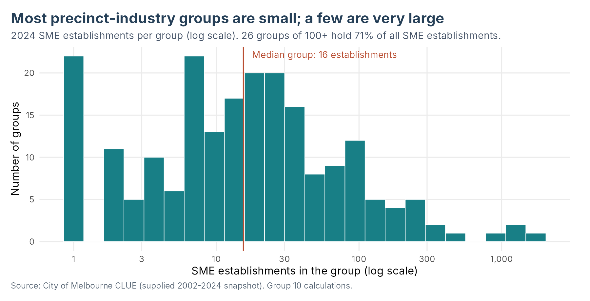
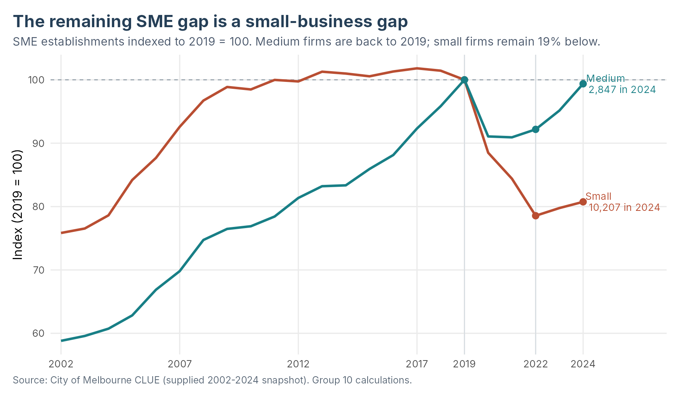
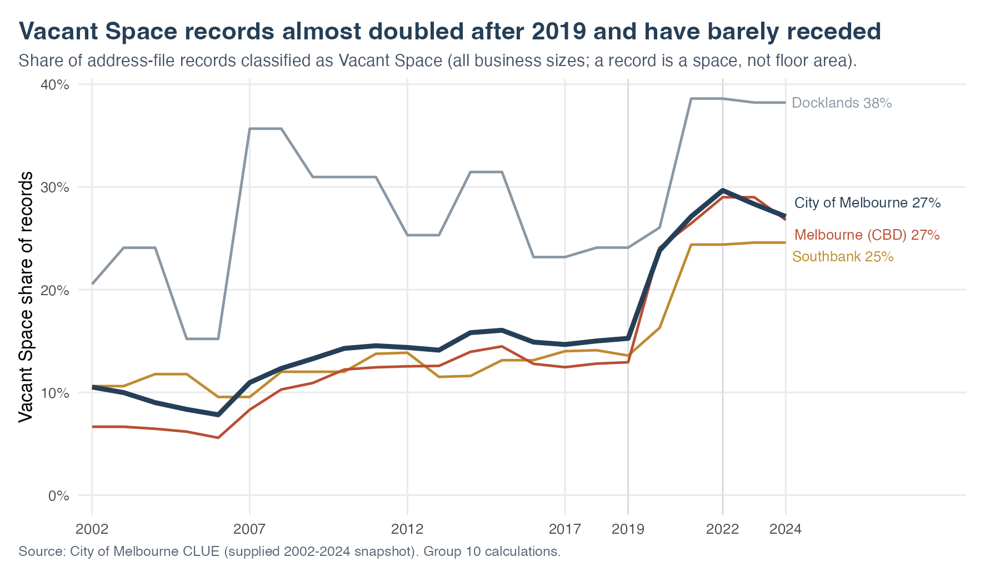
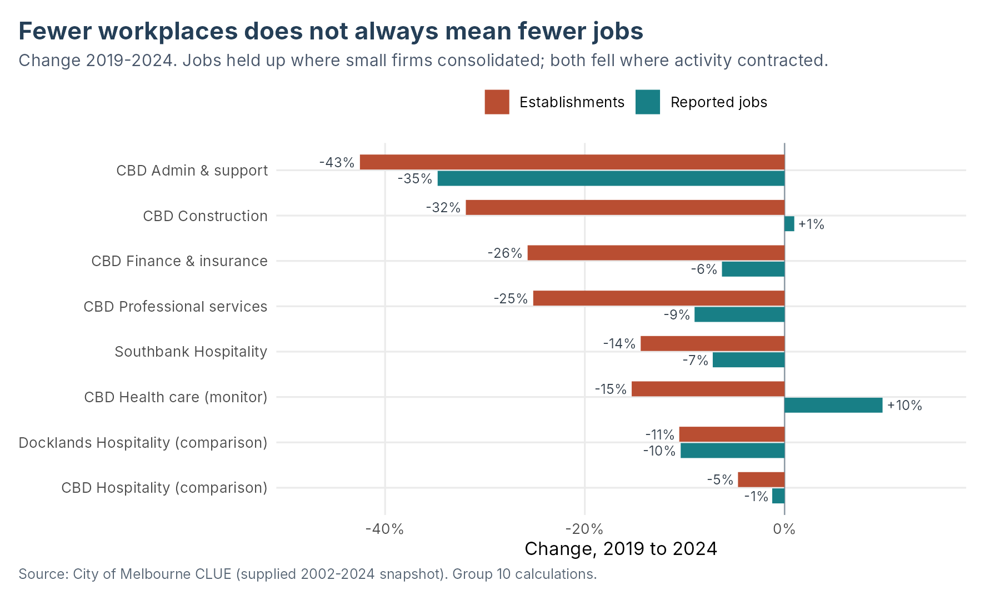

# Melbourne SME Recovery: Where Business Presence Remains Weak

**CMCE30005 Business Analytics Challenge — Group 10 Final Project Report**<br>
University of Melbourne, Semester 2, 2026<br>
Angelyne Leang, Wayne Cao, Yixi Wang and Megan Suprapto<br>
Repository: https://github.com/wayne-232/CMCE30005--Group10

1. [Introduction](#1-introduction)
2. [Problem Definition and Objectives](#2-problem-definition-and-objectives)
3. [Data Description and Preparation](#3-data-description-and-preparation)
4. [Methodology](#4-methodology)
5. [Analysis and Results](#5-analysis-and-results)
6. [Key Findings and Recommendations](#6-key-findings-and-recommendations)
7. [Limitations and Future Work](#7-limitations-and-future-work)
8. [References](#references)
9. [Appendix](#appendix)

## 1. Introduction

The Lord Mayor of Melbourne wants to know how the city's business landscape has
changed since COVID-19 and where small and medium-sized enterprises (SMEs) need
support (CMCE30005, 2026). SMEs were 91% of the City of Melbourne's 14,338
business locations in 2024, so their recovery shapes street activity, employment
and the use of commercial space. A rising city-wide total can hide precincts and
industries that are still losing businesses. With limited support budgets, the
City needs to know which groups are weakest and why.

We analyse the City of Melbourne's Census of Land Use and Employment (CLUE) for
2002–2024 and turn the broad recovery question into a short, evidence-based list
of precinct–industry groups for the City's attention.

## 2. Problem Definition and Objectives

**Research question:** Which precinct–industry groups show the greatest evidence
of persistent SME weakness, and where should the City prioritise further support?

Objectives:

1. Measure how far SME establishment counts have recovered from 2019, by
   precinct and industry.
2. Identify groups whose weakness is persisting, and explain each using jobs,
   business size and vacant space.
3. Test whether a predictive model can anticipate group-level change better than
   assuming no change.

**Scope.** Small and Medium businesses (1–199 jobs) across all 13 CLUE precincts
and 19 ANZSIC industry divisions. Individual firm survival, the causal effect of
COVID-19, and the design, costing or evaluation of specific programmes are
outside scope.

## 3. Data Description and Preparation

### 3.1 Data source and unit of analysis

We use two files from the City of Melbourne's Census of Land Use and Employment
(CLUE), covering 2002–2024. The aggregated file (13,353 rows) gives establishment
and job counts by census year, precinct, ANZSIC industry division and business
size. Each row is a count for one year–precinct–industry–size cell, so rows do
not represent individual businesses. We keep Small (1–19 jobs) and Medium (20–199
jobs) businesses, leaving 8,800 rows across 13 precincts and 19 industries, and
sum the two sizes into one count per precinct–industry group per year. An
establishment is a business location, so one company can appear more than once.
The address file (413,550 records) has no business-size field, so we use it only
to check totals and to measure vacant space.

### 3.2 Cleaning and data quality

Grouping keys are unique, establishment counts are complete non-negative
integers, and precinct and industry totals reconcile exactly to the city total.
Job counts are blank in 4,252 rows (31.8%), but only in cells with one or two
establishments, which matches CLUE's confidentiality rule. These cells hold about
1% of SME establishments, so reported jobs cover 99% of them and we use jobs as a
supporting measure. The address file contains 68,299 Vacant Space records with a
dummy industry code of 0. They are spaces that surveyors found empty, so we
exclude them from business counts and analyse them separately as a measure of
unused commercial space.

## 4. Methodology

### 4.1 Comparison years

CLUE surveys blocks on a rolling two-year cycle, and the data show it: outside
the CBD, a precinct's SME total is identical to the previous year's in 128 of 264
year pairs (48%). A one-year change often reflects survey timing, so we compare
years at least two apart: 2019 (pre-pandemic), 2022 (start of the recovery) and
2024 (latest). Because the median group has only 16 establishments, we report
percentage changes only where the starting count is at least 100.

### 4.2 Priority screen and case selection

We flag precinct–industry groups that were below their 2019 count in 2024 and
fell again between 2022 and 2024. From these we select the four largest absolute
shortfalls among groups that fell by at least 2% after 2022. We add the largest
hospitality shortfall outside the CBD as a contrast case, because hospitality
produced most of the city's recent growth. Jobs and the small–medium split are
then used to interpret each case.

### 4.3 Predictive approach

We test whether each group's two-year change can be predicted. The target is the
count at t+2 minus the count at t, using even-year origins (2004–2022) so that
windows match the survey cycle and do not overlap. Predictors are the current
count, its logarithm, the previous two-year change, precinct and industry. We
compare a no-change benchmark with multiple linear regression, a pruned
regression tree and gradient boosting. Settings are chosen by mean absolute error
(MAE) over four expanding-window validation periods, and the 2022–2024 change is
held out as the final test (Hyndman & Athanasopoulos, 2021).

## 5. Analysis and Results

### 5.1 Data exploration

Group sizes are highly skewed (Figure 1). The median precinct–industry group had
16 SME establishments in 2024, while the 26 groups with 100 or more held 71% of
the total. A few large CBD groups therefore drive most city-level change.



### 5.2 Descriptive analytics

**Recovery is partial.** SME establishments fell from 15,506 in 2019 to 12,571 in
2022 and rose to 13,054 in 2024. This recovers 16.5% of the loss and leaves a gap
of 2,452 (15.8%). All 13 precincts remain below 2019. The CBD holds 65.0% of the
gap and also produced 50.7% of the gain since 2022.

**The gap is a small-business gap (Figure 2).** Small establishments are 2,434
(19.3%) below 2019, while medium establishments are 18 (0.6%) below. Reported SME
jobs fell only 6.2%, so jobs per establishment rose from 14.9 to 16.6. The shift
began before the pandemic: from 2009 to 2019, medium establishments grew by 31%
and small ones by 1%.



**Hospitality growth is concentrated in the CBD.** Accommodation and Food
Services added 214 establishments after 2022, 180 of them in the CBD. In
Southbank and Docklands hospitality fell by 10 and 15, with small venues down 15
and 24. CBD professional services, administrative support and finance kept
shrinking after 2022 (−45, −24 and −20).

**Vacant space remains high (Figure 3).** Vacant Space rose from 15.3% of address
records in 2019 to 27.1% in 2024, and CBD vacant records doubled to 2,884.
Southbank's share did not fall after 2022 (24.4% to 24.6%).



**Shortfalls persist.** Of the 153 groups below 2019 in 2022, only 22 had
recovered by 2024. The 64 groups flagged by the screen hold 60.2% of the city's
gap and lost a further 282 establishments after 2022, while all other groups
gained 764.

### 5.3 Five priority groups

The five groups have 876 fewer establishments than in 2019 (35.7% of the city's
gap) and lost 114 more after 2022. Small firms account for 96% of their combined
gap. CBD health care ranks fourth by gap but changed by only −0.9% after 2022,
and its jobs rose 9.8%, so we keep it on a watch list.

| Group | 2019 | 2022 | 2024 | Gap since 2019 | Change since 2022 | Jobs, 2019–24 |
| --- | ---: | ---: | ---: | ---: | ---: | ---: |
| CBD Professional, Scientific & Technical | 1,788 | 1,383 | 1,338 | −450 (−25.2%) | −45 (−3.3%) | −9.0% |
| CBD Financial & Insurance | 719 | 554 | 534 | −185 (−25.7%) | −20 (−3.6%) | −6.3% |
| CBD Administrative & Support | 381 | 243 | 219 | −162 (−42.5%) | −24 (−9.9%) | −34.7% |
| CBD Construction | 141 | 111 | 96 | −45 (−31.9%) | −15 (−13.5%) | +1.0% |
| Southbank Accommodation & Food | 236 | 212 | 202 | −34 (−14.4%) | −10 (−4.7%) | −7.2% |



- **CBD professional services (−450).** Small practices account for 428 of the
  lost locations, while jobs fell only 9%, which points to consolidation into
  larger practices.
- **CBD finance and insurance (−185).** Small offices fell by 204 while medium
  firms grew by 19, and jobs fell 6.3%.
- **CBD administrative and support services (−162).** This is the only case where
  jobs fell almost as fast as establishments (−34.7% against −42.5%), with both
  small and medium firms shrinking. It is the clearest case of contraction.
- **CBD construction (−45).** Establishments fell 31.9% while jobs rose 1.0%, and
  every lost location was a small firm. It also had the sharpest decline after
  2022 (−13.5%).
- **Southbank hospitality (−34).** Small venues fell by 30 and were still falling
  after 2022, while CBD hospitality grew. The weakness is local to the precinct.

### 5.4 Predictive results

| Model | MAE, 2022–24 | RMSE, 2022–24 |
| --- | ---: | ---: |
| No change (benchmark) | 5.13 | 15.45 |
| Pruned regression tree | 5.77 | 20.91 |
| Gradient boosting | 5.85 | 22.22 |
| Multiple linear regression | 6.17 | 20.22 |

Errors are in establishments per group. RMSE weights large errors more heavily.

No fitted model beat the no-change benchmark on either measure. In the test period 80.2% of groups
changed by five establishments or fewer, so the current count was the best guide
to the next. The fitted models also over-predicted decline. Their training data
included the two pandemic windows, when the average group lost 8.6 and 5.9
establishments, so they forecast net losses of 193 to 418 when the matched groups
gained 481. We therefore set priorities from observed gaps and recent change.

## 6. Key Findings and Recommendations

### 6.1 Key findings

1. **Recovery is partial.** Melbourne has regained 16.5% of its pandemic loss in
   SME establishments and remains 2,452 (15.8%) below 2019.
2. **Small firms hold almost all of the gap.** Establishments with 1–19 jobs
   account for 99% of the shortfall; medium firms are back at their 2019 level.
3. **Shortfalls are persisting.** Only 22 of the 153 groups below 2019 in 2022
   had recovered by 2024, and no model beat a no-change forecast.
4. **Four CBD service groups are still shrinking.** Administrative support is
   contracting in both firms and jobs; professional services, finance and
   construction are consolidating into fewer, larger firms.
5. **Hospitality's recovery is confined to the CBD.** Small venues in Southbank
   and Docklands kept declining after 2022, and Southbank's vacancy share has not
   improved.

### 6.2 Recommendations

1. **Direct SME support to small establishments (1–19 jobs).** Medium firms have
   recovered, so eligibility and outreach should centre on the smallest firms.
2. **Give CBD administrative and support services first priority for
   consultation.** It is the only case shrinking in jobs as well as locations.
3. **Help small professional, finance and construction firms keep a CBD
   presence.** Activity in these industries has moved to larger firms. With
   2,884 vacant CBD spaces, the supply and cost of small office space is a
   specific question for consultation with these industries.
4. **Treat Southbank hospitality as a local issue.** A city-wide hospitality
   measure would mostly reach the CBD, where venues are already growing; the
   City should look at precinct-level conditions in Southbank, and Docklands
   alongside it.
5. **Monitor CBD health care and rerun the screen on each new CLUE release.**
   The screen and case rule are reproducible, so the list can be refreshed when
   the 2026 data arrive.

## 7. Limitations and Future Work

- CLUE counts business locations and does not identify firms, openings or
  closures, so consolidation is inferred from counts and jobs.
- Vacant Space covers businesses of all sizes and gives no floor area.
- Each published year mixes surveys from that year and the year before.
- The models were validated on four periods and tested on one. The main
  improvement is to mark the pandemic years explicitly. Refitted without the two
  pandemic windows, linear regression (RMSE 14.70) and the regression tree
  (15.30) beat the benchmark's RMSE of 15.45, so the models do carry information
  about the large groups; on MAE the benchmark still leads (5.13 against 5.15 for
  gradient boosting). This is a post-hoc diagnostic and was not used to select a
  model.
- Future work could model small-business counts separately, add leading
  indicators such as vacancy and pedestrian counts, and test the screen
  prospectively on the 2026 CLUE release.

## References

Anthropic. (2026). *Claude* (Opus 5.5) [Large language model]. https://claude.ai/

City of Melbourne. (n.d.-a). *Business establishments and jobs data by business
size and ANZSIC in small areas* [Data set].
https://discover.data.vic.gov.au/dataset/business-establishments-and-jobs-data-by-business-size-and-anzsic-in-small-areas

City of Melbourne. (n.d.-b). *Business establishments location and industry
classification* [Data set].
https://discover.data.vic.gov.au/dataset/business-establishments-location-and-industry-classification

City of Melbourne. (n.d.-c). *Census of Land Use and Employment definitions*.
https://data.melbourne.vic.gov.au/api/datasets/1.0/buildings-with-name-age-size-accessibility-and-bicycle-facilities/attachments/clue_definitions_pdf/

CMCE30005. (2026). *Business establishments in Melbourne project brief* and
*Final project report instructions*. University of Melbourne.
https://canvas.lms.unimelb.edu.au/courses/251386/modules (university login
required).

Hyndman, R. J., & Athanasopoulos, G. (2021). *Forecasting: Principles and
practice* (3rd ed.). OTexts. https://otexts.com/fpp3/

OpenAI. (2026). *Codex* [AI coding assistant]. https://chatgpt.com/codex

All figures and tables are Group 10 calculations from the supplied CLUE files.
[Data provenance, licence and checksums](data/README.md) identify the exact
snapshot.

## Appendix

### A. AI acknowledgement

Claude (Anthropic, 2026) reviewed and extended the R code and edited the data
sections. Codex (OpenAI, 2026) reviewed earlier versions of the R scripts. The
group reviewed all AI-assisted work and is responsible for this submission.
Details are in the [AI assistance record](docs/AI_ASSISTANCE.md).

### B. Supporting analysis

- [Full final analysis with model settings and diagnostics](analysis/02_final_analysis.md)
  ([HTML](analysis/02_final_analysis.html), [R Markdown](analysis/02_final_analysis.Rmd))
- [Data audit and descriptive analysis under both SME definitions](analysis/01_descriptive_analytics.md)
- [Exported tables](outputs/tables/final/): descriptive results, model scores and
  predictions, the 64-group screen (`descriptive/persistent_decline_groups.csv`),
  the five cases and watch list, and the insight tables behind Figures 1–4.
- [Code review guide](docs/FINAL_CODE_REVIEW.md) and [validation record](docs/VALIDATION.md)

### C. Reproducing the results

Clone the repository (both raw CSVs are in [data/](data/)) and run from the
repository root:

```sh
Rscript scripts/install_dependencies.R   # once
Rscript scripts/run_final_analysis.R
```

The second command runs both test suites, renders both reports, and rebuilds the
insight tables, Figures 1–4 and the pandemic-window diagnostic. Raw files are
never modified, and their checksums are verified at the end of the run. R 4.1+
and Pandoc (included with RStudio) are required.

The interim report submitted in September is preserved in the Git history.
