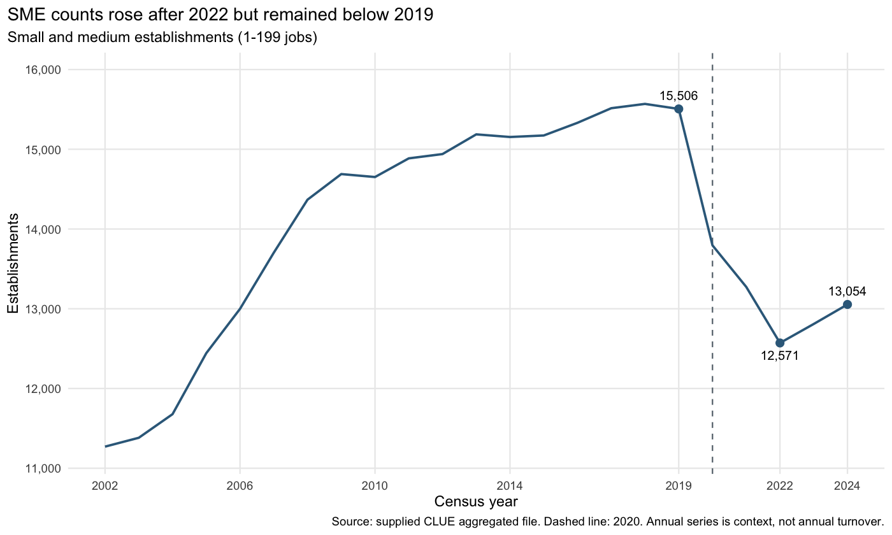
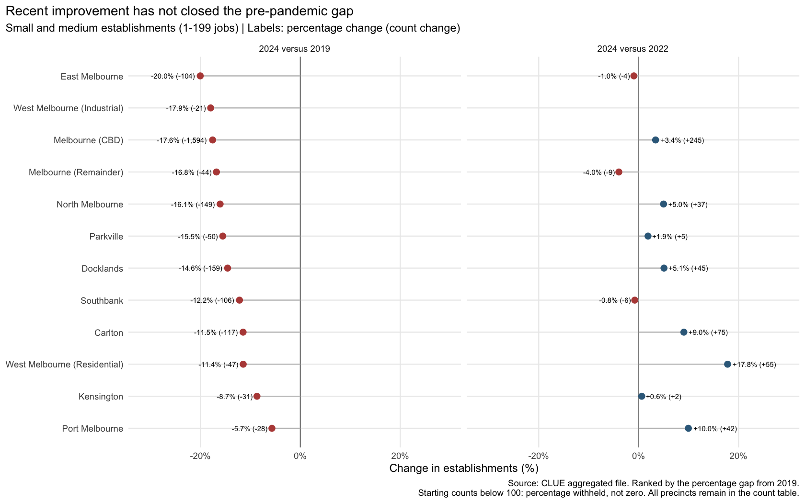
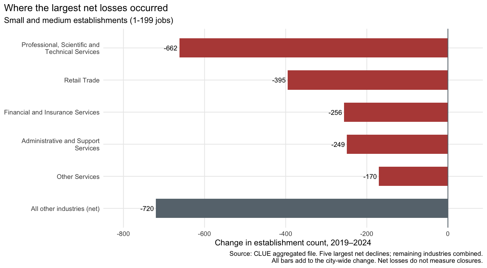

# CMCE30005 Business Analytics Challenge

## Group 10 — Melbourne SME Establishments

**Interim Project Report | Updated 17 September 2026**<br>
University of Melbourne, Semester 2, 2026<br>
Angelyne Leang, Wayne Cao, Yixi Wang and Megan Suprapto

This README presents the interim report for team review. The [two project datasets](data/)
are included in the repository. The [full R analysis](analysis/01_descriptive_analytics.md),
[code](analysis/01_descriptive_analytics.Rmd) and [results](outputs/tables/employing_only/)
provide supporting detail. The group still needs to check this version against its
final shared report and submit a Word/PDF copy to LMS.

## 1. Introduction

The Lord Mayor of Melbourne wants to understand how the city's business landscape
has changed and where small and medium-sized businesses may need support
(CMCE30005, 2026). A city-wide total is a useful starting point, but it can hide
different experiences across precincts and industries. A district may have more
business establishments than it did recently while still remaining below its
pre-pandemic level. Distinguishing these patterns helps the City decide where
further investigation would be useful.

We use the City of Melbourne's Census of Land Use and Employment (CLUE), which
provides a consistent local source of establishment counts and industry
classifications. The supplied files cover 2002–2024, allowing us to consider both
long-term changes and the period around COVID-19.

This interim report sets out the scope, explains the data decisions and presents
the descriptive analysis completed so far. The final project will test a simple
forecasting approach and use the findings to identify areas for consultation.
Specific support measures will require evidence about local conditions, costs
and likely effectiveness.

## 2. Problem Definition and Objectives

**Research question: How have small and medium-sized business establishment
patterns evolved across Melbourne precincts and industries from 2002 to 2024?**

The analysis first examines the city-wide trend, then compares precincts and
industries. This sequence connects the overall picture with the local patterns
that the City needs to understand.

The main sample uses CLUE's Small and Medium business categories: establishments
with 1–199 jobs. Non-employing establishments are tested separately, and large
establishments are outside the main sample. We retain all 13 precincts and 19
industry divisions. CLUE measures business locations, so one company can appear
at several locations (City of Melbourne, n.d.-a, n.d.-b).

Two comparisons define recovery in establishment counts. The difference between
2024 and 2019 measures the remaining pre-pandemic gap. The difference between 2024
and 2022 measures recent change. We do not assume 2022 was every area's lowest
point. The project does not estimate individual closures, firm survival,
employment growth or the causal effect of COVID-19. These require evidence beyond
the selected counts.

## 3. Data Description

The aggregated file contains 13,353 rows and six columns: census year, precinct,
industry, business size, establishment count and job count. Each row represents
a group of establishments, so we sum the published counts rather than count rows.
The address file contains 413,550 records and 12 columns. It supports classification
and all-size count checks but has no business-size field, so it cannot identify
SMEs.

The R workflow checks data types, missing values, duplicate keys and invalid
counts before selecting the sample. Establishment counts have no missing values.
Job counts are blank in 4,252 aggregate rows (31.8%), consistent with CLUE's
confidentiality rule for cells containing two or fewer establishments
(City of Melbourne, n.d.-a). We retain these rows and leave missing jobs as NA.

The address file contains 68,299 Vacant Space observations across the full period.
They are a recorded category, not missing values or a count of business closures.
We preserve them in the raw data and separate them for the address-based count
check. They are not an industry category in the aggregated SME file.

EDA shows that city counts increased after 2022 but remained below 2019.
Comparisons are at least two years apart, following CLUE guidance
(City of Melbourne, n.d.-c). Large counts are retained; displayed percentages with
baselines below 100 are withheld to avoid misleading small-base comparisons.

## 4. Methodology and Analytical Approach

R produces the data checks, summaries and charts from the same source files.
Long-run lines provide context, while comparisons use 2019, 2022 and 2024.
Absolute changes show the number of establishments involved. Percentage changes
show change relative to the starting count. Neither measure alone provides a
complete ranking of need. For example, a large precinct can account for many
lost establishments without having the largest percentage decline.

We check that precinct and industry totals add to the selected city total.
An alternative sample includes non-employing establishments to test whether the
main interpretation depends on the SME definition. Missing group-year combinations
remain unavailable rather than being filled with zero.

The planned predictive stage will forecast precinct counts two years ahead.
A simple time-trend regression will be compared with a no-change forecast. We
will train on earlier dates and test on later dates using two-year-spaced
observations, keeping test outcomes out of model fitting. Mean absolute error
and root mean squared error will be reported by precinct as well as overall.
This will show whether a model adds value and whether the CBD dominates the errors.
The short series and pandemic break may limit forecast accuracy.

Recommendations will combine the remaining gap, recent direction and industry
breakdowns to identify areas for consultation. This is not yet evidence that a
particular subsidy or intervention will work.

## 5. Analysis Completed and Next Steps

### Overall change

SME establishments fell from 15,506 in 2019 to 13,054 in 2024, a decline of 15.8%.
However, the 2024 total was 483 establishments, or 3.8%, above 2022. This indicates
a partial recovery in counts, not a return to the 2019 level.



### Differences between precincts

All 13 precincts remained below their 2019 counts, while eight increased between
2022 and 2024. Melbourne CBD recorded the largest numerical decline since 2019:
1,594 establishments. Counts and percentages should be read together.



### Industry patterns and next steps

Professional, Scientific and Technical Services recorded the largest city-wide
industry decline since 2019, at 662 establishments. Industry totals locate where
the net losses occurred; they do not explain their causes.



Data checks, descriptive analysis and the SME-definition comparison are complete.
Including non-employing establishments leaves the direction of 2019–2024 changes
unchanged across precincts and industries, although some recent-change directions
differ. Next, the team will confirm the reporting definition, test the forecasts
and investigate local context before recommending support. Power BI is reserved
for a later presentation; the current report uses static figures.

## References

City of Melbourne. (n.d.-a). *Business establishments and jobs data by business
size and ANZSIC in small areas* [Data set].
[DataVic metadata](https://discover.data.vic.gov.au/dataset/business-establishments-and-jobs-data-by-business-size-and-anzsic-in-small-areas).

City of Melbourne. (n.d.-b). *Business establishments location and industry
classification* [Data set].
[DataVic metadata](https://discover.data.vic.gov.au/dataset/business-establishments-location-and-industry-classification).

City of Melbourne. (n.d.-c). *Census of Land Use and Employment definitions*.
[CLUE definitions](https://data.melbourne.vic.gov.au/api/datasets/1.0/buildings-with-name-age-size-accessibility-and-bicycle-facilities/attachments/clue_definitions_pdf/).

CMCE30005. (2026). *Business establishments in Melbourne project brief* and
*Interim Project Report instructions*. University of Melbourne.
[Project module](https://canvas.lms.unimelb.edu.au/courses/251386/modules)
and [assignment](https://canvas.lms.unimelb.edu.au/courses/251386/assignments/680898)
(university login required).

All figures are Group 10 calculations from the supplied CLUE aggregated file.
[Data provenance, licence information and checksums](data/README.md) identify the
exact snapshot; public metadata may describe a different date range.

## AI acknowledgement

Claude helped review code. Codex helped with brainstorming, English editing,
code and chart revisions, and validation checks. Incorporated code and text
are acknowledged in the [AI assistance record](docs/AI_ASSISTANCE.md), which also
lists the tools and outputs. The group remains responsible for reviewing the
analysis, sources and submitted wording.

## Supporting material and reproduction

- [Full analysis with code, tables and additional charts](analysis/01_descriptive_analytics.md)
- [Downloadable HTML report](analysis/01_descriptive_analytics.html)
- [Team review guide](docs/TEAM_REVIEW.md)
- [Validation record](docs/VALIDATION.md)
- [R scripts](scripts/) and [tests](tests/)
- [Results using Small + Medium](outputs/tables/employing_only/)
- [Alternative results including non-employing establishments](outputs/tables/including_non_employing/)

<details>
<summary>How to run the analysis</summary>

Download the whole repository or clone it, then open the existing `.Rproj` in
RStudio. Both raw CSVs are now included in `data/`; no separate data download is
needed. Keep the original files unchanged.

Install dependencies once:

```r
install.packages(c("tidyverse", "scales", "knitr", "rmarkdown"))
```

Run from the repository root:

```sh
Rscript tests/test_analysis.R
Rscript scripts/render_reports.R
```

R 4.1+, dplyr 1.1.0+ and Pandoc are required. RStudio includes Pandoc. The report
records package versions. No packages or data are downloaded while knitting.
Dependencies are documented but not pinned in a lockfile.

In RStudio, Knit also builds the HTML report. To use the alternative SME scope:

```sh
Rscript scripts/render_reports.R --include-non-employing
```

This replaces both main reports with the alternative scope. Run again without
the flag to restore Small + Medium. Each scope has separate exported tables.
The README's figures and narrative use Small + Medium: restore the default
before publishing, and do not mix the two sets of results.

</details>
