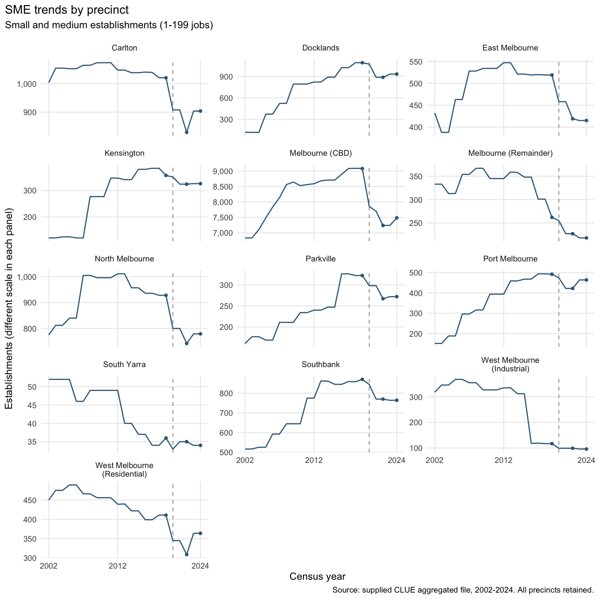
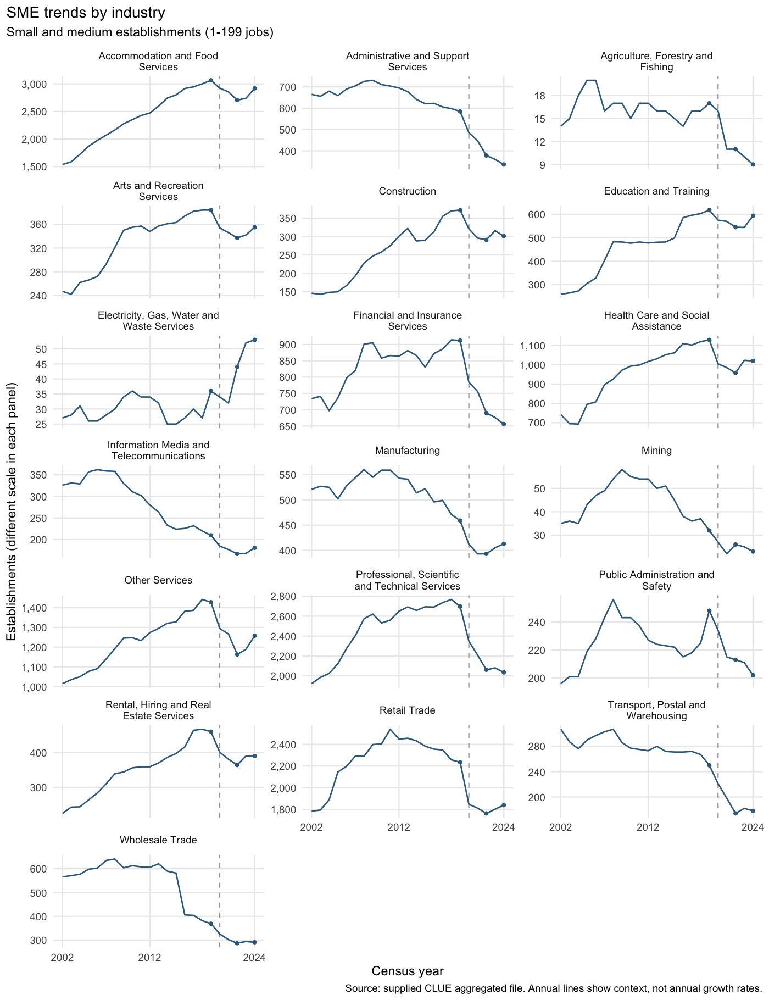
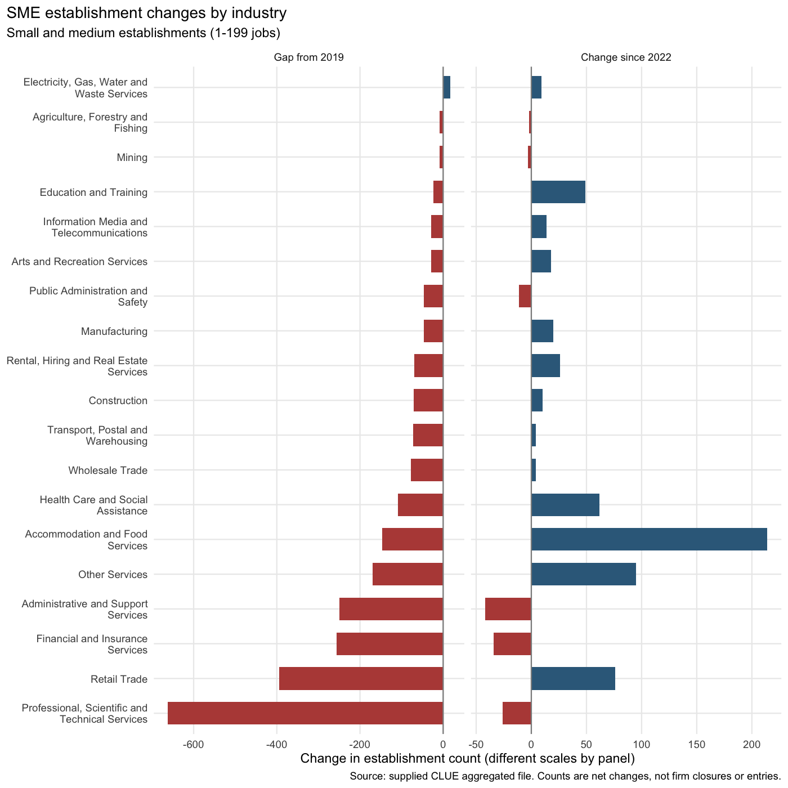
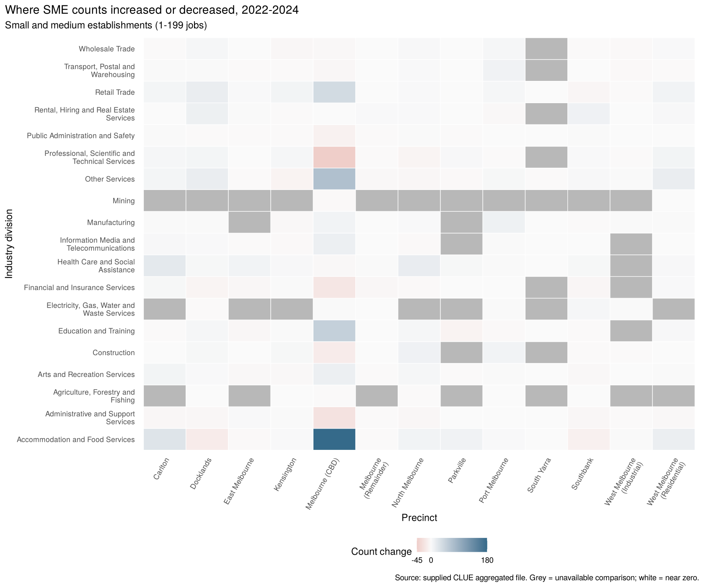

Melbourne SME Establishments: Trends and Recovery
================
Group 10
21 October 2026

- [1. What this report answers](#1-what-this-report-answers)
  - [Reading guide and scope](#reading-guide-and-scope)
- [2. What is in the two files?](#2-what-is-in-the-two-files)
  - [2.1 Check missing information before
    filtering](#21-check-missing-information-before-filtering)
  - [2.2 Validate the aggregated file](#22-validate-the-aggregated-file)
  - [2.3 Separate Vacant Space from missing
    values](#23-separate-vacant-space-from-missing-values)
  - [2.4 Check counts between files](#24-check-counts-between-files)
- [3. Define the sample and
  comparisons](#3-define-the-sample-and-comparisons)
  - [3.1 Select the population once](#31-select-the-population-once)
  - [3.2 Separate the remaining gap from recent
    recovery](#32-separate-the-remaining-gap-from-recent-recovery)
- [4. How have SME counts changed?](#4-how-have-sme-counts-changed)
  - [4.1 City-wide trend](#41-city-wide-trend)
  - [4.2 Small and medium businesses can move
    differently](#42-small-and-medium-businesses-can-move-differently)
- [5. Which precincts are
  recovering?](#5-which-precincts-are-recovering)
  - [5.1 Long-run precinct patterns](#51-long-run-precinct-patterns)
  - [5.2 Recent improvement and the remaining
    gap](#52-recent-improvement-and-the-remaining-gap)
- [6. Which industries account for the
  changes?](#6-which-industries-account-for-the-changes)
  - [6.1 Compare industry counts](#61-compare-industry-counts)
  - [6.2 Does industry composition
    change?](#62-does-industry-composition-change)
  - [6.3 Connect precincts and
    industries](#63-connect-precincts-and-industries)
- [7. Does the SME definition affect the
  results?](#7-does-the-sme-definition-affect-the-results)
- [8. Findings and next steps](#8-findings-and-next-steps)
  - [8.1 Findings calculated from the selected
    sample](#81-findings-calculated-from-the-selected-sample)
  - [8.2 Use the results to guide further
    investigation](#82-use-the-results-to-guide-further-investigation)
  - [8.3 Final analysis](#83-final-analysis)
- [9. Checks, exports and
  reproducibility](#9-checks-exports-and-reproducibility)
  - [9.1 Review checklist](#91-review-checklist)
  - [9.2 Technical details](#92-technical-details)
- [10. Sources and acknowledgement](#10-sources-and-acknowledgement)

<style>
table { font-size: 0.9em; }
td, th { overflow-wrap: anywhere; }
pre { overflow-x: auto; }
</style>

# 1. What this report answers

This document contains the data checks and descriptive analysis. The
[final analysis](02_final_analysis.html) adds the deeper industry
comparisons, model evaluation and decision-support results.

**Research question:** How have small and medium-sized business
establishment patterns evolved across Melbourne precincts and industries
from 2002 to 2024?

**Client:** The Lord Mayor of the City of Melbourne. The results help
identify where SME support and further investigation may be needed.

This report answers three questions:

1.  How have SME establishment counts changed over the full period?
2.  Which precincts and industries increased or decreased between 2022
    and 2024?
3.  How far were they above or below their 2019 counts in 2024?

**Population in the main results: Small and medium establishments (1-199
jobs).**

The main analysis includes Small business and Medium business. Section 7
checks the effect of adding CLUE’s separate Non employing category;
`include_non_employing` controls this sensitivity analysis.

CLUE counts **business locations**, not unique legal companies. One
company can have several establishments. Size is based on jobs at the
establishment, not necessarily the size of the whole company \[1, 2\].

## Reading guide and scope

Sections 2-3 cover data decisions, Sections 4-7 present results, and
Section 8 sets out next steps. In the HTML report, use **Code** to
inspect calculations. A dash (`--`) means unavailable or withheld under
the display rule, never zero.

This report does not estimate individual firm survival, openings or
closures, vacancy rates, total employment growth, or the causal effect
of COVID-19. A net decline in counts is not a count of closures.

# 2. What is in the two files?

The **aggregated file** supplies the SME analysis. One row is a census
year, precinct, industry division and business-size category. We sum
`total_establishments`, not the number of rows: a row with a value of 15
represents 15 establishments.

The **address-level file** supports classification and count checks. It
has no business-size variable, so it cannot identify SMEs. We compare
yearly totals across the files; joining their raw rows would risk
duplicating counts.

``` r
aggregate_filename <- "business-establishments-and-jobs-data-by-business-size-and-anzsic.csv"
address_filename <- "business-establishments-with-address-and-industry-classification.csv"
# A blank data_dir means the repository's data/ folder.
DATA_DIR <- if (nzchar(params$data_dir)) params$data_dir else file.path(PROJECT_ROOT, "data")
aggregate_path <- file.path(DATA_DIR, aggregate_filename)
address_path <- file.path(DATA_DIR, address_filename)
assert_true(all(file.exists(c(aggregate_path, address_path))),
            "Place BOTH supplied CSV files in data/, or set the data_dir parameter.")

# Explicit types protect identifiers and expose parsing errors. Zero stays zero.
aggregate_raw <- read_csv(aggregate_path, na = c("", "NA"),
  col_types = cols(.default = col_character(), `Census year` = col_integer(),
                   `Total establishments` = col_double(), `Total jobs` = col_double()))
location_raw <- read_csv(address_path, na = c("", "NA"),
  col_types = cols(.default = col_character(), census_year = col_integer(),
                   industry_anzsic4_code = col_integer(), longitude = col_double(),
                   latitude = col_double()))
assert_true(nrow(problems(aggregate_raw)) == 0, "Aggregated CSV has parsing problems.")
assert_true(nrow(problems(location_raw)) == 0, "Address CSV has parsing problems.")
require_columns(aggregate_raw, c("Census year", "CLUE small area", "ANZSIC indusrty",
  "Business size", "Total establishments", "Total jobs"), "Aggregated CSV")
require_columns(location_raw, c("census_year", "block_id", "property_id",
  "base_property_id", "clue_small_area", "trading_name", "business_address",
  "industry_anzsic4_code", "industry_anzsic4_description", "longitude", "latitude",
  "point"), "Address CSV")
file_overview <- tibble(
  File = c("Aggregated", "Address-level"),
  Rows = c(nrow(aggregate_raw), nrow(location_raw)),
  Columns = c(ncol(aggregate_raw), ncol(location_raw)),
  `First year` = c(min(aggregate_raw$`Census year`), min(location_raw$census_year)),
  `Last year` = c(max(aggregate_raw$`Census year`), max(location_raw$census_year)))
report_table(file_overview)
```

| File          |    Rows | Columns | First year | Last year |
|:--------------|--------:|--------:|-----------:|----------:|
| Aggregated    |  13,353 |       6 |      2,002 |     2,024 |
| Address-level | 413,550 |      12 |      2,002 |     2,024 |

The report uses the supplied snapshot without downloading updates.
Section 9 records file checksums so other users can verify their copies.

## 2.1 Check missing information before filtering

Each table checks **all rows in that file** before filtering.
Percentages use the row count of the respective file as their
denominator.

``` r
aggregate_missing <- missing_audit(aggregate_raw, "Aggregated")
location_missing <- missing_audit(location_raw, "Address-level")
report_table(select(aggregate_missing, -dataset),
  col.names = c("Variable", "Rows checked", "Missing", "Blank strings", "Missing (%)"))
```

| Variable             | Rows checked | Missing | Blank strings | Missing (%) |
|:---------------------|-------------:|--------:|--------------:|------------:|
| Census year          |       13,353 |       0 |             0 |         0.0 |
| CLUE small area      |       13,353 |       0 |             0 |         0.0 |
| ANZSIC indusrty      |       13,353 |       0 |             0 |         0.0 |
| Business size        |       13,353 |       0 |             0 |         0.0 |
| Total establishments |       13,353 |       0 |             0 |         0.0 |
| Total jobs           |       13,353 |   4,252 |             0 |        31.8 |

``` r
report_table(select(location_missing, -dataset),
  col.names = c("Variable", "Rows checked", "Missing", "Blank strings", "Missing (%)"))
```

| Variable                     | Rows checked | Missing | Blank strings | Missing (%) |
|:-----------------------------|-------------:|--------:|--------------:|------------:|
| census_year                  |      413,550 |       0 |             0 |         0.0 |
| block_id                     |      413,550 |       0 |             0 |         0.0 |
| property_id                  |      413,550 |       0 |             0 |         0.0 |
| base_property_id             |      413,550 |       0 |             0 |         0.0 |
| clue_small_area              |      413,550 |       0 |             0 |         0.0 |
| trading_name                 |      413,550 |     127 |             0 |         0.0 |
| business_address             |      413,550 |       1 |             0 |         0.0 |
| industry_anzsic4_code        |      413,550 |       0 |             0 |         0.0 |
| industry_anzsic4_description |      413,550 |       0 |             0 |         0.0 |
| longitude                    |      413,550 |   4,785 |             0 |         1.2 |
| latitude                     |      413,550 |   4,785 |             0 |         1.2 |
| point                        |      413,550 |   4,785 |             0 |         1.2 |

Our decisions are:

- **Missing jobs:** retain the row for establishment-count analysis. Do
  not replace missing jobs with zero or discard a known establishment
  count.
- **Missing names, addresses or coordinates:** retain the record for
  count comparisons with the required year and precinct. Mapping or
  matching individual locations would need further checks of those
  fields.
- **Missing counts or essential grouping information:** stop and
  investigate.
- **Vacant Space:** handle as a category in Section 2.3, not as missing
  data.

## 2.2 Validate the aggregated file

We rename the source’s misspelled `ANZSIC indusrty` heading and check
size labels, grouping keys and counts before filtering. Unexpected
values stop the analysis.

``` r
aggregate <- aggregate_raw %>%
  rename(census_year = `Census year`, precinct = `CLUE small area`,
         industry = `ANZSIC indusrty`, business_size = `Business size`,
         total_establishments = `Total establishments`, total_jobs = `Total jobs`)
expected_sizes <- c("Non employing", "Small business", "Medium business", "Large business")
assert_true(setequal(unique(aggregate$business_size), expected_sizes),
            "Unexpected size labels. Check the source before selecting SMEs.")
check_key(aggregate, c("census_year", "precinct", "industry", "business_size"), "Aggregated file")
assert_true(!anyNA(aggregate$total_establishments), "Establishment counts contain missing values.")
assert_true(all(aggregate$total_establishments >= 0 & is.finite(aggregate$total_establishments) &
                 aggregate$total_establishments == floor(aggregate$total_establishments)),
            "Establishment counts must be non-negative whole numbers.")
assert_true(all(is.na(aggregate$total_jobs) | (is.finite(aggregate$total_jobs) &
                 aggregate$total_jobs >= 0 & aggregate$total_jobs == floor(aggregate$total_jobs))),
            "Reported job counts must be non-negative whole numbers.")
assert_true(!any(trimws(aggregate$precinct) == "" | trimws(aggregate$industry) == ""),
            "A precinct or industry label is blank.")
assert_true(all(START_YEAR:END_YEAR %in% aggregate$census_year), "Required census years are absent.")
assert_true(!any(grepl("Vacant Space", aggregate$industry, fixed = TRUE)),
            "The aggregated source now includes a vacancy category. Review the scope.")
jobs_check <- aggregate %>% summarise(rows = n(), missing_jobs = sum(is.na(total_jobs)),
  missing_jobs_pct = 100 * mean(is.na(total_jobs)),
  missing_jobs_in_cells_above_two = sum(is.na(total_jobs) & total_establishments > 2))
report_table(jobs_check, col.names = c("Rows", "Missing jobs", "Missing jobs (%)",
                                    "Missing jobs in cells with >2 establishments"))
```

|   Rows | Missing jobs | Missing jobs (%) | Missing jobs in cells with \>2 establishments |
|-------:|-------------:|-----------------:|----------------------------------------------:|
| 13,353 |        4,252 |             31.8 |                                             0 |

The publisher withholds job counts in cells with two or fewer businesses
to protect confidentiality \[1\]. In this snapshot, 4,252 job values are
blank (31.8%). All are in cells containing at most two establishments,
consistent with that rule. This percentage describes aggregate rows with
blank job counts, not the share of businesses or jobs missing.

## 2.3 Separate Vacant Space from missing values

CLUE uses special industry categories for non-economic activities,
including Vacant Space \[2, section 28\]. A location can have a complete
address and coordinates while being classified as vacant.

We retain all source records and exclude explicit vacancies only from
the address-based establishment count check. This cannot correct survey
lag or identify every closed business. Historical records remain
unchanged. CLUE distinguishes unoccupied, unused and vacant space \[2,
sections 41, 44-46\]; we do not infer vacancy rates, whole-building
vacancy or its causes here.

``` r
assert_true(!anyNA(location_raw$census_year) && !anyNA(location_raw$clue_small_area),
            "Address records have missing year or precinct. Investigate before counting.")
assert_true(anyDuplicated(location_raw) == 0,
            "Exact duplicate address rows found. Investigate before removing anything.")
location <- classify_locations(location_raw)
location_categories <- count(location, record_type, name = "records")
report_table(location_categories, col.names = c("Record category", "Records across all years"))
```

| Record category              | Records across all years |
|:-----------------------------|-------------------------:|
| Industry-coded establishment |                  345,251 |
| Vacant Space                 |                   68,299 |

``` r
assert_true(!any(location$record_type == "Needs review"),
            "Some address classifications need review before selecting establishments.")
location_operating <- filter(location, record_type == "Industry-coded establishment")
location_vacant <- filter(location, record_type == "Vacant Space")
assert_true(nrow(location_operating) + nrow(location_vacant) == nrow(location_raw),
            "Address categories do not reconcile to the source rows.")
```

The 68,299 vacancy observations cover the entire supplied time series.
They are not that many unique buildings or business closures. Multiple
records at one property may be separate establishments, so we do not
deduplicate by property ID or address.

The next table checks missing fields **within the vacant subset only**.
It does not describe missing values across the full file.

``` r
vacancy_missing <- missing_audit(select(location_vacant, all_of(names(location_raw))),
                                "Vacant subset only")
report_table(select(vacancy_missing, -dataset),
  col.names = c("Variable", "Vacant rows checked", "Missing", "Blank strings", "Missing (%)"))
```

| Variable                     | Vacant rows checked | Missing | Blank strings | Missing (%) |
|:-----------------------------|--------------------:|--------:|--------------:|------------:|
| census_year                  |              68,299 |       0 |             0 |         0.0 |
| block_id                     |              68,299 |       0 |             0 |         0.0 |
| property_id                  |              68,299 |       0 |             0 |         0.0 |
| base_property_id             |              68,299 |       0 |             0 |         0.0 |
| clue_small_area              |              68,299 |       0 |             0 |         0.0 |
| trading_name                 |              68,299 |     109 |             0 |         0.2 |
| business_address             |              68,299 |       0 |             0 |         0.0 |
| industry_anzsic4_code        |              68,299 |       0 |             0 |         0.0 |
| industry_anzsic4_description |              68,299 |       0 |             0 |         0.0 |
| longitude                    |              68,299 |   1,094 |             0 |         1.6 |
| latitude                     |              68,299 |   1,094 |             0 |         1.6 |
| point                        |              68,299 |   1,094 |             0 |         1.6 |

## 2.4 Check counts between files

This check uses **all business sizes**. The address file cannot supply
an SME-only total. Similar totals do not establish a record-by-record
match.

``` r
all_size_yearly <- sum_establishments(aggregate)
address_yearly <- location %>% group_by(census_year) %>%
  summarise(address_records = n(), vacant_records = sum(record_type == "Vacant Space"),
    industry_coded_records = sum(record_type == "Industry-coded establishment"), .groups = "drop")
reconciliation <- full_join(all_size_yearly, address_yearly,
                            by = "census_year", relationship = "one-to-one") %>%
  mutate(difference = industry_coded_records - establishments)
assert_true(!anyNA(reconciliation), "The two sources do not cover the same years.")
report_table(filter(reconciliation, census_year %in% COMPARISON_YEARS),
  col.names = c("Year", "Aggregated total", "All address records", "Vacant records",
                "Industry-coded records", "Difference"))
```

|  Year | Aggregated total | All address records | Vacant records | Industry-coded records | Difference |
|------:|-----------------:|--------------------:|---------------:|-----------------------:|-----------:|
| 2,019 |           16,713 |              19,730 |          3,011 |                 16,719 |          6 |
| 2,022 |           13,828 |              19,659 |          5,831 |                 13,828 |          0 |
| 2,024 |           14,338 |              19,672 |          5,335 |                 14,337 |         -1 |

The largest absolute annual difference is 23 records. The cause is
unresolved, so we retain the differences and use the aggregated source
for all main results.

# 3. Define the sample and comparisons

## 3.1 Select the population once

CLUE defines Small business as 1-19 jobs, Medium business as 20-199
jobs, and Non employing as no jobs allocated to the establishment \[1\].
We select using `business_size`, not the incomplete `total_jobs` column.

``` r
aggregate_period <- filter(aggregate, between(census_year, START_YEAR, END_YEAR))
sme <- filter(aggregate_period, business_size %in% SME_CATEGORIES)
assert_true(nrow(sme) > 0, "The selected SME population is empty.")
assert_true(all(SME_CATEGORIES %in% sme$business_size), "A selected category is absent.")
assert_true(setequal(unique(sme$precinct), unique(aggregate_period$precinct)),
            "A precinct has no selected SME records. Investigate coverage.")
sample_log <- tibble(
  Step = c("Raw aggregated file", "Within 2002-2024", "Selected SME categories"),
  `Aggregated rows` = c(nrow(aggregate), nrow(aggregate_period), nrow(sme)),
  Action = c("Retain source", "Apply study period", "Apply size definition"))
report_table(sample_log)
```

| Step                    | Aggregated rows | Action                |
|:------------------------|----------------:|:----------------------|
| Raw aggregated file     |          13,353 | Retain source         |
| Within 2002-2024        |          13,353 | Apply study period    |
| Selected SME categories |           8,800 | Apply size definition |

The sample covers 13 precincts and 19 industry divisions. The log counts
aggregated rows; no row is dropped for missing jobs. Large businesses
remain available for context.

## 3.2 Separate the remaining gap from recent recovery

- **Gap from 2019:** 2024 count minus 2019 count. The percentage
  denominator is the 2019 count. Has the area returned to its pre-COVID
  establishment level?
- **Change since 2022:** 2024 count minus 2022 count. The percentage
  denominator is the 2022 count. Have counts recently increased?

An area can remain below 2019 while increasing since 2022. We describe
this as partial recovery in establishment counts; it says nothing about
profitability or the cause of the change.

CLUE publishes a constructed annual series based on its survey cycle.
Its guidance recommends comparison years at least two years apart \[2,
section 12\]. We use 2019, 2022 and 2024. The common 2022 comparison
point is **not assumed to be every precinct’s or industry’s lowest
year**. Annual lines show context; we do not calculate year-on-year
entry, exit or growth rates.

``` r
city_yearly <- sum_establishments(sme)
precinct_yearly <- sum_establishments(sme, "precinct")
industry_yearly <- sum_establishments(sme, "industry")
precinct_industry_yearly <- sum_establishments(sme, c("precinct", "industry"))
size_yearly <- sum_establishments(aggregate_period, "business_size")
city_comparison <- compare_years(city_yearly, years = COMPARISON_YEARS, min_base = MIN_BASELINE)
precinct_comparison <- compare_years(precinct_yearly, "precinct", COMPARISON_YEARS, MIN_BASELINE)
industry_comparison <- compare_years(industry_yearly, "industry", COMPARISON_YEARS, MIN_BASELINE)
precinct_industry_comparison <- compare_years(precinct_industry_yearly,
  c("precinct", "industry"), COMPARISON_YEARS, MIN_BASELINE)
size_comparison <- compare_years(size_yearly, "business_size", COMPARISON_YEARS, MIN_BASELINE)

# Every yearly breakdown must add to the SAME selected city total.
for (breakdown in list(precinct_yearly, industry_yearly, precinct_industry_yearly)) {
  check <- breakdown %>% group_by(census_year) %>%
    summarise(check_total = sum(establishments), .groups = "drop") %>%
    full_join(city_yearly, by = "census_year", relationship = "one-to-one")
  assert_true(!anyNA(check) && all(check$check_total == check$establishments),
              "A grouped summary does not add to the selected city total.")
}
```

**Small baselines:** we withhold displayed percentages where the
starting count is below 100, while retaining counts in all totals. This
is our display rule, not a CLUE rule. Exports include calculated rates
and small-baseline flags. Use counts for South Yarra.

# 4. How have SME counts changed?

## 4.1 City-wide trend

``` r
report_table(filter(city_yearly, census_year %in% COMPARISON_YEARS),
             col.names = c("Year", "Selected SME establishments"))
```

|  Year | Selected SME establishments |
|------:|----------------------------:|
| 2,019 |                      15,506 |
| 2,022 |                      12,571 |
| 2,024 |                      13,054 |

The selected population changed from **15,506 in 2019** to **13,054 in
2024**: -2,452 establishments (-15.8%). Between 2022 and 2024, the
change was +483 (+3.8%).

``` r
city_title <- if (city_comparison$gap_count < 0 && city_comparison$recovery_count > 0) {
  "SME counts rose after 2022 but remained below 2019"
} else "SME establishment counts over time"
ggplot(city_yearly, aes(census_year, establishments)) +
  geom_vline(xintercept = 2020, linetype = "dashed", colour = GREY) +
  geom_line(colour = BLUE, linewidth = .9) +
  geom_point(data = filter(city_yearly, census_year %in% COMPARISON_YEARS), colour = BLUE, size = 2.7) +
  geom_text(data = filter(city_yearly, census_year %in% COMPARISON_YEARS),
            aes(label = comma(establishments),
                vjust = if_else(census_year == 2022L, 1.8, -1)), size = 3.6) +
  scale_x_continuous(breaks = c(2002, 2006, 2010, 2014, 2019, 2022, 2024)) +
  scale_y_continuous(labels = comma, expand = expansion(mult = c(.08, .15))) +
  labs(title = city_title, subtitle = SCOPE_LABEL,
       x = "Census year", y = "Establishments",
       caption = "Source: supplied CLUE aggregated file. Dashed line: 2020. Annual series is context, not annual turnover.")
```


## 4.2 Small and medium businesses can move differently

Categories marked Yes are included in the main results. Establishments
can move between size categories, so count changes alone cannot identify
closures or mergers.

``` r
size_display <- size_comparison %>%
  mutate(Included = if_else(business_size %in% SME_CATEGORIES, "Yes", "No")) %>%
  select(business_size, Included, n_pre, n_recovery_start, n_latest, gap_count, recovery_count)
report_table(size_display, col.names = c("Size category", "In main analysis", "2019", "2022",
                                       "2024", "Change 2019-24", "Change 2022-24"))
```

| Size category   | In main analysis |   2019 |  2022 |   2024 | Change 2019-24 | Change 2022-24 |
|:----------------|:-----------------|-------:|------:|-------:|---------------:|---------------:|
| Large business  | No               |    379 |   376 |    426 |             47 |             50 |
| Medium business | Yes              |  2,865 | 2,641 |  2,847 |            -18 |            206 |
| Non employing   | No               |    828 |   881 |    858 |             30 |            -23 |
| Small business  | Yes              | 12,641 | 9,930 | 10,207 |         -2,434 |            277 |

# 5. Which precincts are recovering?

## 5.1 Long-run precinct patterns

Each panel shows a precinct’s trend, including changes before COVID-19.
**Vertical scales differ**; compare direction within panels, not line
heights between them.

``` r
ggplot(precinct_yearly, aes(census_year, establishments)) +
  geom_vline(xintercept = 2020, linetype = "dashed", colour = "grey65") +
  geom_line(colour = BLUE, linewidth = .65) +
  geom_point(data = filter(precinct_yearly, census_year %in% COMPARISON_YEARS), colour = BLUE, size = 1.3) +
  facet_wrap(~precinct, scales = "free_y", ncol = 3, labeller = label_wrap_gen(width = 25)) +
  scale_x_continuous(breaks = c(2002, 2012, 2024)) + scale_y_continuous(labels = comma) +
  labs(title = "SME trends by precinct", subtitle = SCOPE_LABEL,
       x = "Census year", y = "Establishments (different scale in each panel)",
       caption = "Source: supplied CLUE aggregated file, 2002-2024. All precincts retained.")
```



## 5.2 Recent improvement and the remaining gap

``` r
report_table(precinct_comparison %>% arrange(precinct) %>%
  select(precinct, n_pre, n_recovery_start, n_latest, gap_count, recovery_count),
  col.names = c("Precinct", "2019", "2022", "2024", "Change 2019-24", "Change 2022-24"))
```

| Precinct                     |  2019 |  2022 |  2024 | Change 2019-24 | Change 2022-24 |
|:-----------------------------|------:|------:|------:|---------------:|---------------:|
| Carlton                      | 1,021 |   829 |   904 |           -117 |             75 |
| Docklands                    | 1,092 |   888 |   933 |           -159 |             45 |
| East Melbourne               |   519 |   419 |   415 |           -104 |             -4 |
| Kensington                   |   357 |   324 |   326 |            -31 |              2 |
| Melbourne (CBD)              | 9,079 | 7,240 | 7,485 |         -1,594 |            245 |
| Melbourne (Remainder)        |   262 |   227 |   218 |            -44 |             -9 |
| North Melbourne              |   928 |   742 |   779 |           -149 |             37 |
| Parkville                    |   322 |   267 |   272 |            -50 |              5 |
| Port Melbourne               |   492 |   422 |   464 |            -28 |             42 |
| South Yarra                  |    36 |    35 |    34 |             -2 |             -1 |
| Southbank                    |   870 |   770 |   764 |           -106 |             -6 |
| West Melbourne (Industrial)  |   117 |    99 |    96 |            -21 |             -3 |
| West Melbourne (Residential) |   411 |   309 |   364 |            -47 |             55 |

Of the 13 precincts, 0 were at or above their 2019 counts in 2024, while
8 increased between 2022 and 2024. These figures cover the selected SME
population.

``` r
# Sort the percentage chart by the displayed 2019 gap, not by count losses.
# Keep the same precinct order in both panels. Labels retain the count change.
precinct_order <- precinct_comparison %>%
  filter(!is.na(gap_pct_display)) %>% arrange(desc(gap_pct_display), precinct) %>% pull(precinct)
precinct_order <- c(setdiff(precinct_comparison$precinct, precinct_order), precinct_order)
precinct_plot <- bind_rows(
  transmute(precinct_comparison, precinct, comparison = "2024 versus 2019",
            change_pct = gap_pct_display, change_count = gap_count),
  transmute(precinct_comparison, precinct, comparison = "2024 versus 2022",
            change_pct = recovery_pct_display, change_count = recovery_count)) %>%
  filter(!is.na(change_pct)) %>%
  mutate(precinct = factor(precinct, levels = precinct_order),
         comparison = factor(comparison, levels = c("2024 versus 2019", "2024 versus 2022")),
         point_label = paste0(sprintf("%+.1f%%", change_pct), " (",
                              if_else(change_count > 0, "+", ""), comma(change_count), ")"))
ggplot(precinct_plot, aes(change_pct, precinct)) +
  geom_vline(xintercept = 0, colour = "grey55") +
  geom_segment(aes(x = 0, xend = change_pct, yend = precinct), colour = "grey75") +
  geom_point(aes(colour = change_pct >= 0), size = 2.8) + facet_wrap(~comparison, nrow = 1) +
  geom_text(aes(label = point_label, hjust = if_else(change_pct >= 0, -.12, 1.12)), size = 2.7) +
  scale_colour_manual(values = c("FALSE" = RED, "TRUE" = BLUE), guide = "none") +
  scale_x_continuous(labels = label_number(suffix = "%"),
                     expand = expansion(mult = c(.38, .38))) +
  labs(title = "Recent improvement has not closed the pre-pandemic gap",
       subtitle = paste(SCOPE_LABEL, "| Labels: percentage change (count change)"),
       x = "Change in establishments (%)", y = NULL,
       caption = paste0("Source: CLUE aggregated file. Ranked by the percentage gap from 2019.\n",
                        "Starting counts below ", MIN_BASELINE,
                        ": percentage withheld, not zero. All precincts remain in the count table."))
```


Use the count table alongside percentages when comparing the CBD with
smaller precincts.

# 6. Which industries account for the changes?

## 6.1 Compare industry counts

For the short report, the next chart shows the five industries with the
largest net count declines from 2019 to 2024. All remaining industries
are combined so the bars still add to the city-wide change. The full
comparisons below retain every industry, including those with increases.

``` r
largest_losses <- industry_comparison %>%
  filter(gap_count < 0) %>% arrange(gap_count, industry) %>% slice_head(n = 5)
other_industries <- industry_comparison %>%
  filter(!industry %in% largest_losses$industry)
industry_summary <- bind_rows(
  select(largest_losses, industry, gap_count),
  tibble(industry = "All other industries (net)", gap_count = sum(other_industries$gap_count)))
assert_true(sum(industry_summary$gap_count) == city_comparison$gap_count,
            "Industry summary must reconcile to the selected city change.")
industry_summary <- industry_summary %>%
  mutate(bar_type = if_else(industry == "All other industries (net)", "Other industries",
                            if_else(gap_count >= 0, "Increase", "Decrease")),
         industry = factor(industry, levels = rev(industry)))
ggplot(industry_summary, aes(gap_count, industry)) +
  geom_col(aes(fill = bar_type), width = .6) +
  geom_vline(xintercept = 0, colour = GREY) +
  geom_text(aes(label = comma(gap_count), hjust = if_else(gap_count >= 0, -.15, 1.15)), size = 3.5) +
  scale_fill_manual(values = c("Decrease" = RED, "Increase" = BLUE,
                               "Other industries" = GREY), guide = "none") +
  scale_x_continuous(labels = comma, expand = expansion(mult = c(.18, .12))) +
  scale_y_discrete(labels = function(x) stringr::str_wrap(x, 32)) +
  labs(title = "Where the largest net losses occurred", subtitle = SCOPE_LABEL,
       x = "Change in establishment count, 2019–2024", y = NULL,
       caption = "Source: CLUE aggregated file. Five largest net declines; remaining industries combined.\nAll bars add to the city-wide change. Net losses do not measure closures.")
```


### Full industry detail

The small-multiple chart supports historical checking. Its panels use
different vertical scales and should not be compared by line height or
slope alone.

The long-run panels show when industry trends began. Each has its own
vertical scale. The comparison table and bars show count changes; the
largest count reduction need not be the largest percentage reduction.

``` r
ggplot(industry_yearly, aes(census_year, establishments)) +
  geom_vline(xintercept = 2020, linetype = "dashed", colour = "grey65") +
  geom_line(colour = BLUE, linewidth = .65) +
  geom_point(data = filter(industry_yearly, census_year %in% COMPARISON_YEARS),
             colour = BLUE, size = 1.2) +
  facet_wrap(~industry, scales = "free_y", ncol = 3,
             labeller = label_wrap_gen(width = 28)) +
  scale_x_continuous(breaks = c(2002, 2012, 2024)) +
  scale_y_continuous(labels = comma) +
  labs(title = "SME trends by industry", subtitle = SCOPE_LABEL,
       x = "Census year", y = "Establishments (different scale in each panel)",
       caption = "Source: supplied CLUE aggregated file. Annual lines show context, not annual growth rates.")
```



``` r
report_table(industry_comparison %>% arrange(gap_count) %>%
  select(industry, n_pre, n_recovery_start, n_latest, gap_count, recovery_count),
  col.names = c("Industry division", "2019", "2022", "2024", "Change 2019-24", "Change 2022-24"))
```

| Industry division                               |  2019 |  2022 |  2024 | Change 2019-24 | Change 2022-24 |
|:------------------------------------------------|------:|------:|------:|---------------:|---------------:|
| Professional, Scientific and Technical Services | 2,697 | 2,061 | 2,035 |           -662 |            -26 |
| Retail Trade                                    | 2,235 | 1,764 | 1,840 |           -395 |             76 |
| Financial and Insurance Services                |   912 |   690 |   656 |           -256 |            -34 |
| Administrative and Support Services             |   585 |   378 |   336 |           -249 |            -42 |
| Other Services                                  | 1,428 | 1,163 | 1,258 |           -170 |             95 |
| Accommodation and Food Services                 | 3,065 | 2,705 | 2,919 |           -146 |            214 |
| Health Care and Social Assistance               | 1,129 |   958 | 1,020 |           -109 |             62 |
| Wholesale Trade                                 |   369 |   287 |   291 |            -78 |              4 |
| Transport, Postal and Warehousing               |   250 |   174 |   178 |            -72 |              4 |
| Construction                                    |   372 |   291 |   301 |            -71 |             10 |
| Rental, Hiring and Real Estate Services         |   460 |   364 |   390 |            -70 |             26 |
| Manufacturing                                   |   459 |   393 |   413 |            -46 |             20 |
| Public Administration and Safety                |   248 |   213 |   202 |            -46 |            -11 |
| Arts and Recreation Services                    |   384 |   337 |   355 |            -29 |             18 |
| Information Media and Telecommunications        |   210 |   167 |   181 |            -29 |             14 |
| Education and Training                          |   618 |   545 |   594 |            -24 |             49 |
| Mining                                          |    32 |    26 |    23 |             -9 |             -3 |
| Agriculture, Forestry and Fishing               |    17 |    11 |     9 |             -8 |             -2 |
| Electricity, Gas, Water and Waste Services      |    36 |    44 |    53 |             17 |              9 |

``` r
industry_plot <- industry_comparison %>%
  mutate(industry = factor(industry, levels = industry[order(gap_count)])) %>%
  select(industry, `Gap from 2019` = gap_count, `Change since 2022` = recovery_count) %>%
  pivot_longer(-industry, names_to = "comparison", values_to = "change_count") %>%
  filter(!is.na(change_count)) %>%
  mutate(comparison = factor(comparison, levels = c("Gap from 2019", "Change since 2022")))
ggplot(industry_plot, aes(change_count, industry)) +
  geom_col(aes(fill = change_count >= 0), width = .65) +
  geom_vline(xintercept = 0, colour = "grey55") +
  facet_wrap(~comparison, nrow = 1, scales = "free_x") +
  scale_y_discrete(labels = function(x) stringr::str_wrap(x, 30)) +
  scale_x_continuous(labels = comma) +
  scale_fill_manual(values = c("FALSE" = RED, "TRUE" = BLUE), guide = "none") +
  labs(title = "SME establishment changes by industry", subtitle = SCOPE_LABEL,
       x = "Change in establishment count (different scales by panel)", y = NULL,
       caption = "Source: supplied CLUE aggregated file. Counts are net changes, not firm closures or entries.")
```



## 6.2 Does industry composition change?

Industry share is the industry’s SME count divided by the city SME total
**in the same year**. These city-wide shares may hide changes within
precincts and do not test whether diversity affects recovery.

``` r
industry_shares <- industry_yearly %>% filter(census_year %in% c(2019L, 2024L)) %>%
  group_by(census_year) %>% mutate(share_pct = 100 * establishments / sum(establishments)) %>%
  ungroup() %>% select(industry, census_year, share_pct) %>%
  pivot_wider(names_from = census_year, values_from = share_pct, names_prefix = "share_") %>%
  mutate(change_pp = share_2024 - share_2019) %>% arrange(desc(abs(change_pp)))
report_table(industry_shares, col.names = c("Industry division", "2019 share (%)",
                                          "2024 share (%)", "Change (percentage points)"))
```

| Industry division                               | 2019 share (%) | 2024 share (%) | Change (percentage points) |
|:------------------------------------------------|---------------:|---------------:|---------------------------:|
| Accommodation and Food Services                 |           19.8 |           22.4 |                        2.6 |
| Professional, Scientific and Technical Services |           17.4 |           15.6 |                       -1.8 |
| Administrative and Support Services             |            3.8 |            2.6 |                       -1.2 |
| Financial and Insurance Services                |            5.9 |            5.0 |                       -0.9 |
| Education and Training                          |            4.0 |            4.6 |                        0.6 |
| Health Care and Social Assistance               |            7.3 |            7.8 |                        0.5 |
| Other Services                                  |            9.2 |            9.6 |                        0.4 |
| Retail Trade                                    |           14.4 |           14.1 |                       -0.3 |
| Transport, Postal and Warehousing               |            1.6 |            1.4 |                       -0.2 |
| Arts and Recreation Services                    |            2.5 |            2.7 |                        0.2 |
| Manufacturing                                   |            3.0 |            3.2 |                        0.2 |
| Electricity, Gas, Water and Waste Services      |            0.2 |            0.4 |                        0.2 |
| Wholesale Trade                                 |            2.4 |            2.2 |                       -0.2 |
| Construction                                    |            2.4 |            2.3 |                       -0.1 |
| Public Administration and Safety                |            1.6 |            1.5 |                       -0.1 |
| Agriculture, Forestry and Fishing               |            0.1 |            0.1 |                        0.0 |
| Information Media and Telecommunications        |            1.4 |            1.4 |                        0.0 |
| Mining                                          |            0.2 |            0.2 |                        0.0 |
| Rental, Hiring and Real Estate Services         |            3.0 |            3.0 |                        0.0 |

## 6.3 Connect precincts and industries

City-wide industry totals can hide local differences. This chart shows
the 2022-2024 **count change** for each precinct-industry combination.
Blue means more establishments, red means fewer. Grey means a source
total was unavailable in at least one comparison year.

Absent source combinations stay unavailable. Small groups, including
South Yarra, remain in the chart. Larger precincts can have larger
changes because of their size.

``` r
grid_changes <- precinct_industry_comparison %>%
  complete(precinct = sort(unique(sme$precinct)), industry = sort(unique(sme$industry)))
ggplot(grid_changes, aes(precinct, industry, fill = recovery_count)) +
  geom_tile(colour = "white", linewidth = .3) +
  scale_fill_gradient2(low = RED, mid = "#FAFAFA", high = BLUE, midpoint = 0,
                       na.value = "#B8B8B8", name = "Count change",
                       breaks = function(limits) sort(unique(c(limits, 0))),
                       labels = label_number(accuracy = 1)) +
  scale_x_discrete(labels = function(x) stringr::str_wrap(x, 18)) +
  scale_y_discrete(labels = function(x) stringr::str_wrap(x, 32)) +
  labs(title = "Where SME counts increased or decreased, 2022-2024", subtitle = SCOPE_LABEL,
       x = "Precinct", y = "Industry division",
       caption = "Source: supplied CLUE aggregated file. Grey = unavailable comparison; white = near zero.") +
  theme(axis.text.x = element_text(angle = 60, hjust = 1, size = 9),
        axis.text.y = element_text(size = 9), panel.grid = element_blank())
```



39 combinations have no available 2022-2024 comparison under this rule.
They should not be read as zero change.

# 7. Does the SME definition affect the results?

We repeat city, precinct and industry comparisons with and without
non-employing businesses, using the same snapshot.

``` r
scope_options <- list(
  `Small + medium only` = c("Small business", "Medium business"),
  `Non-employing + small + medium` = c("Non employing", "Small business", "Medium business"))
scope_city <- imap_dfr(scope_options, function(categories, label) {
  filtered <- filter(aggregate_period, business_size %in% categories)
  compare_years(sum_establishments(filtered), years = COMPARISON_YEARS,
                min_base = MIN_BASELINE) %>% mutate(scope = label, .before = 1)
})
scope_precinct <- imap_dfr(scope_options, function(categories, label) {
  filtered <- filter(aggregate_period, business_size %in% categories)
  compare_years(sum_establishments(filtered, "precinct"), "precinct",
                COMPARISON_YEARS, MIN_BASELINE) %>% mutate(scope = label, .before = 1)
})
scope_industry <- imap_dfr(scope_options, function(categories, label) {
  filtered <- filter(aggregate_period, business_size %in% categories)
  compare_years(sum_establishments(filtered, "industry"), "industry",
                COMPARISON_YEARS, MIN_BASELINE) %>% mutate(scope = label, .before = 1)
})
report_table(scope_city %>% select(scope, n_pre, n_latest, gap_pct, recovery_pct),
  col.names = c("Definition", "2019", "2024", "Change 2019-24 (%)", "Change 2022-24 (%)"))
```

| Definition                     |   2019 |   2024 | Change 2019-24 (%) | Change 2022-24 (%) |
|:-------------------------------|-------:|-------:|-------------------:|-------------------:|
| Small + medium only            | 15,506 | 13,054 |              -15.8 |                3.8 |
| Non-employing + small + medium | 16,334 | 13,912 |              -14.8 |                3.4 |

``` r
scope_direction_check <- bind_rows(
  scope_precinct %>% mutate(level = "Precinct", group = precinct),
  scope_industry %>% mutate(level = "Industry", group = industry)
) %>% group_by(level, group) %>% summarise(
  comparable = all(!is.na(gap_count) & !is.na(recovery_count)),
  gap_direction_changes = if (comparable) n_distinct(sign(gap_count)) > 1 else NA,
  recent_direction_changes = if (comparable) n_distinct(sign(recovery_count)) > 1 else NA,
  .groups = "drop")
report_table(scope_direction_check %>% group_by(level) %>%
  summarise(groups_checked = n(), unavailable = sum(!comparable),
            changed_gap_direction = sum(gap_direction_changes, na.rm = TRUE),
            changed_recent_direction = sum(recent_direction_changes, na.rm = TRUE), .groups = "drop"),
  col.names = c("Level", "Groups", "Not comparable", "2019-24 direction changes", "2022-24 direction changes"))
```

| Level    | Groups | Not comparable | 2019-24 direction changes | 2022-24 direction changes |
|:---------|-------:|---------------:|--------------------------:|--------------------------:|
| Industry |     19 |              0 |                         0 |                         1 |
| Precinct |     13 |              0 |                         0 |                         2 |

The check compares increase, decrease and no change. Magnitudes and
rankings can differ even when directions agree. Full results for both
definitions are exported for the group’s scope decision.

# 8. Findings and next steps

## 8.1 Findings calculated from the selected sample

``` r
largest_industry_gap <- industry_comparison %>% filter(!is.na(gap_count)) %>%
  arrange(gap_count, industry) %>% slice_head(n = 1)
largest_precinct_gap <- precinct_comparison %>% filter(!is.na(gap_count)) %>%
  arrange(gap_count, precinct) %>% slice_head(n = 1)
findings <- tibble(Finding = c(
  paste0("Population: ", SCOPE_LABEL, "."),
  paste0("City count: ", fmt_count(city_comparison$n_pre), " in 2019 and ",
         fmt_count(city_comparison$n_latest), " in 2024 (", fmt_pct(city_comparison$gap_pct), ")."),
  paste0("Change from 2022 to 2024: ", fmt_change(city_comparison$recovery_count),
         " establishments (", fmt_pct(city_comparison$recovery_pct), ")."),
  paste0(sum(precinct_comparison$gap_count < 0, na.rm = TRUE), " of ", nrow(precinct_comparison),
         " precincts were below 2019; ", sum(precinct_comparison$recovery_count > 0, na.rm = TRUE),
         " increased between 2022 and 2024."),
  paste0("Largest precinct decline in count since 2019: ", largest_precinct_gap$precinct,
         " (", fmt_change(largest_precinct_gap$gap_count), ")."),
  paste0("Largest industry decline in count since 2019: ", largest_industry_gap$industry,
         " (", fmt_change(largest_industry_gap$gap_count), ").")))
report_table(findings)
```

| Finding                                                                                               |
|:------------------------------------------------------------------------------------------------------|
| Population: Small and medium establishments (1-199 jobs).                                             |
| City count: 15,506 in 2019 and 13,054 in 2024 (-15.8%).                                               |
| Change from 2022 to 2024: +483 establishments (+3.8%).                                                |
| 13 of 13 precincts were below 2019; 8 increased between 2022 and 2024.                                |
| Largest precinct decline in count since 2019: Melbourne (CBD) (-1,594).                               |
| Largest industry decline in count since 2019: Professional, Scientific and Technical Services (-662). |

## 8.2 Use the results to guide further investigation

``` r
follow_up <- precinct_comparison %>% arrange(recovery_count) %>%
  select(precinct, recovery_status, gap_count, recovery_count)
report_table(follow_up, col.names = c("Precinct", "Count pattern", "Change 2019-24", "Change 2022-24"))
```

| Precinct                     | Count pattern                     | Change 2019-24 | Change 2022-24 |
|:-----------------------------|:----------------------------------|---------------:|---------------:|
| Melbourne (Remainder)        | Below 2019; decreasing since 2022 |            -44 |             -9 |
| Southbank                    | Below 2019; decreasing since 2022 |           -106 |             -6 |
| East Melbourne               | Below 2019; decreasing since 2022 |           -104 |             -4 |
| West Melbourne (Industrial)  | Below 2019; decreasing since 2022 |            -21 |             -3 |
| South Yarra                  | Below 2019; decreasing since 2022 |             -2 |             -1 |
| Kensington                   | Below 2019; increasing since 2022 |            -31 |              2 |
| Parkville                    | Below 2019; increasing since 2022 |            -50 |              5 |
| North Melbourne              | Below 2019; increasing since 2022 |           -149 |             37 |
| Port Melbourne               | Below 2019; increasing since 2022 |            -28 |             42 |
| Docklands                    | Below 2019; increasing since 2022 |           -159 |             45 |
| West Melbourne (Residential) | Below 2019; increasing since 2022 |            -47 |             55 |
| Carlton                      | Below 2019; increasing since 2022 |           -117 |             75 |
| Melbourne (CBD)              | Below 2019; increasing since 2022 |         -1,594 |            245 |

- For precincts still declining, identify which industries account for
  the losses.
- For precincts growing again, check whether gains are broad or
  concentrated.
- Check redevelopment, relocations and boundary changes before
  explaining causes.
- Assess costs, eligibility and evidence of effectiveness before
  proposing support.

## 8.3 Final analysis

The separate [final analysis](02_final_analysis.html) compares no
change, multiple linear regression, a pruned regression tree and
gradient boosting. The target is the two-year change in a
precinct-industry group’s SME count. Earlier rolling validation periods
select settings before the 2022-2024 evaluation. It reports errors,
sample coverage and sensitivity to the SME definition.

The same analysis compares the remaining count gap with recent direction
to identify groups for further investigation. The shortlist describes
observed conditions; it does not estimate the effects or costs of a
proposed policy.

# 9. Checks, exports and reproducibility

Checks stop on parsing errors, missing essential fields, duplicate
aggregate keys, unexpected size labels or unresolved address categories.
They verify that precinct and industry totals add to the selected city
totals.

Exports contain aggregate results only. Each SME definition has its own
folder.

``` r
manifest <- tibble(file = c(aggregate_filename, address_filename),
  bytes = as.numeric(file.info(c(aggregate_path, address_path))$size),
  md5 = unname(tools::md5sum(c(aggregate_path, address_path))))
run_settings <- tibble(setting = c("start_year", "end_year", "comparison_years",
  "include_non_employing", "small_baseline_display_threshold"),
  value = c(as.character(START_YEAR), as.character(END_YEAR),
    paste(COMPARISON_YEARS, collapse = ", "), as.character(params$include_non_employing),
    as.character(MIN_BASELINE)))
result_tables <- list(file_manifest = manifest, run_settings = run_settings,
  missing_values = bind_rows(aggregate_missing, location_missing),
  vacancy_subset_missing_values = vacancy_missing, location_categories = location_categories,
  sample_log = sample_log, source_reconciliation = reconciliation,
  city_yearly = city_yearly, precinct_yearly = precinct_yearly, industry_yearly = industry_yearly,
  city_comparison = city_comparison, precinct_comparison = precinct_comparison,
  industry_comparison = industry_comparison, precinct_industry_comparison = precinct_industry_comparison,
  business_size_comparison = size_comparison, industry_shares = industry_shares,
  scope_city = scope_city, scope_precinct = scope_precinct, scope_industry = scope_industry,
  scope_direction_check = scope_direction_check, findings = findings)
if (params$export_tables) {
  OUTPUT_DIR <- file.path(PROJECT_ROOT, "outputs", "tables", SCOPE_KEY)
  dir.create(OUTPUT_DIR, recursive = TRUE, showWarnings = FALSE)
  iwalk(result_tables, function(table, name) write_csv(table, file.path(OUTPUT_DIR, paste0(name, ".csv"))))
}
report_table(run_settings, col.names = c("Setting", "Value"))
```

| Setting                          | Value            |
|:---------------------------------|:-----------------|
| start_year                       | 2002             |
| end_year                         | 2024             |
| comparison_years                 | 2019, 2022, 2024 |
| include_non_employing            | FALSE            |
| small_baseline_display_threshold | 100              |

``` r
report_table(manifest, col.names = c("Source file", "Bytes", "MD5 checksum"))
```

| Source file                                                           |      Bytes | MD5 checksum                     |
|:----------------------------------------------------------------------|-----------:|:---------------------------------|
| business-establishments-and-jobs-data-by-business-size-and-anzsic.csv |    946,127 | 092490f73fa22c83c82d95d1ccd7e010 |
| business-establishments-with-address-and-industry-classification.csv  | 79,271,999 | 84f61da018f6d302999bb447e4036708 |

## 9.1 Review checklist

Before submission, confirm the SME definition, check that copied figures
use the right population and dates, and review sources and
acknowledgements. Further review questions are in `docs/TEAM_REVIEW.md`.

Run `Rscript tests/test_analysis.R` from the repository root for unit
checks and independent raw-data checks under both definitions. Run
`Rscript scripts/render_reports.R` to rebuild the GitHub Markdown and
HTML reports. The complete `scripts/` folder is required alongside this
Rmd.

## 9.2 Technical details

Establishment count is numerical; year is a time index. Precinct,
industry and size are categorical variables. The table below summarises
**published aggregate cells in 2024**, not individual business sizes.
Absent combinations are excluded from these cell statistics, not counted
as zeros.

``` r
cell_statistics <- sme %>% filter(census_year == END_YEAR) %>%
  summarise(published_cells = n(), mean = mean(total_establishments),
    median = median(total_establishments), sd = sd(total_establishments),
    min = min(total_establishments), max = max(total_establishments))
report_table(cell_statistics)
```

| published_cells | mean | median |    sd | min |   max |
|----------------:|-----:|-------:|------:|----:|------:|
|             383 | 34.1 |      7 | 116.2 |   1 | 1,421 |

``` r
# Trim print padding so generated Markdown has no trailing whitespace.
cat(trimws(capture.output(sessionInfo()), which = "right"), sep = "\n")
```

    R version 4.3.3 (2024-02-29)
    Platform: x86_64-pc-linux-gnu (64-bit)
    Running under: Ubuntu 24.04.5 LTS

    Matrix products: default
    BLAS:   /usr/lib/x86_64-linux-gnu/blas/libblas.so.3.12.0
    LAPACK: /usr/lib/x86_64-linux-gnu/lapack/liblapack.so.3.12.0

    locale:
     [1] LC_CTYPE=C.UTF-8       LC_NUMERIC=C           LC_TIME=C.UTF-8
     [4] LC_COLLATE=C.UTF-8     LC_MONETARY=C.UTF-8    LC_MESSAGES=C.UTF-8
     [7] LC_PAPER=C.UTF-8       LC_NAME=C              LC_ADDRESS=C
    [10] LC_TELEPHONE=C         LC_MEASUREMENT=C.UTF-8 LC_IDENTIFICATION=C

    time zone: Australia/Melbourne
    tzcode source: system (glibc)

    attached base packages:
    [1] stats     graphics  grDevices utils     datasets  methods   base

    other attached packages:
     [1] knitr_1.45      scales_1.3.0    lubridate_1.9.3 forcats_1.0.0
     [5] stringr_1.5.1   dplyr_1.1.4     purrr_1.0.2     readr_2.1.5
     [9] tidyr_1.3.1     tibble_3.2.1    ggplot2_3.4.4   tidyverse_2.0.0

    loaded via a namespace (and not attached):
     [1] sass_0.4.8       utf8_1.2.4       generics_0.1.3   stringi_1.8.3
     [5] lattice_0.22-5   hms_1.1.3        digest_0.6.34    magrittr_2.0.3
     [9] evaluate_0.23    grid_4.3.3       timechange_0.3.0 gbm_2.1.8.1
    [13] fastmap_1.1.1    jsonlite_1.8.8   Matrix_1.6-5     survival_3.5-8
    [17] fansi_1.0.5      jquerylib_0.1.4  cli_3.6.2        crayon_1.5.2
    [21] rlang_1.1.3      bit64_4.0.5      munsell_0.5.0    splines_4.3.3
    [25] withr_2.5.0      cachem_1.0.8     yaml_2.3.8       parallel_4.3.3
    [29] tools_4.3.3      tzdb_0.4.0       colorspace_2.1-0 vctrs_0.6.5
    [33] R6_2.5.1         rpart_4.1.23     lifecycle_1.0.4  bit_4.0.5
    [37] vroom_1.6.5      pkgconfig_2.0.3  pillar_1.9.0     bslib_0.6.1
    [41] gtable_0.3.4     glue_1.7.0       highr_0.10       xfun_0.41
    [45] tidyselect_1.2.0 farver_2.1.1     htmltools_0.5.7  labeling_0.4.3
    [49] rmarkdown_2.25   compiler_4.3.3

# 10. Sources and acknowledgement

1.  City of Melbourne. *Business establishments and jobs data by
    business size and ANZSIC in small areas*. [Official metadata on
    DataVic](https://discover.data.vic.gov.au/dataset/business-establishments-and-jobs-data-by-business-size-and-anzsic-in-small-areas).
    Source for size definitions and confidentiality treatment. Analysis
    uses the supplied snapshot, not a live download.
2.  City of Melbourne. *Census of Land Use and Employment definitions*.
    [Official
    definitions](https://data.melbourne.vic.gov.au/api/datasets/1.0/buildings-with-name-age-size-accessibility-and-bicycle-facilities/attachments/clue_definitions_pdf/).
    Sections 12 (survey timing), 24 (establishments), 28 (industry), and
    41, 44-46 (space-use terminology).
3.  City of Melbourne. *Business establishments location and industry
    classification*. [Official
    metadata](https://discover.data.vic.gov.au/dataset/business-establishments-location-and-industry-classification).
    The supplied snapshot’s coverage is reported in Section 2.
4.  CMCE30005. *Business establishments in Melbourne Project Brief* and
    *Interim Project Report instructions*, Semester 2, 2026. Source for
    the client and scope.

**AI assistance:** Claude helped review code. Codex helped with
brainstorming, English editing, code and chart revisions, and validation
checks (OpenAI, 2026). See the [AI assistance
record](../docs/AI_ASSISTANCE.md) for tool references and examples. The
group must review the final analysis before submission.
