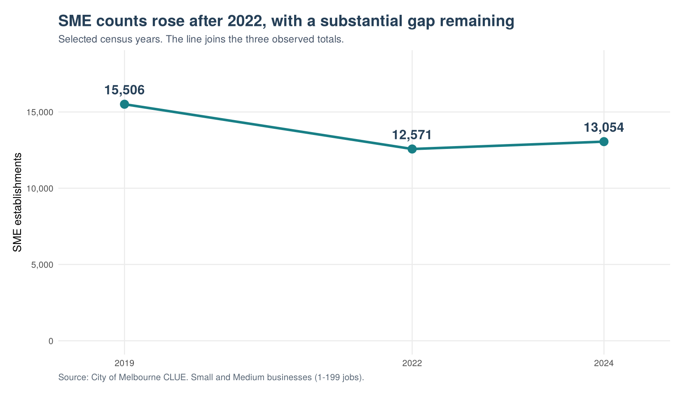
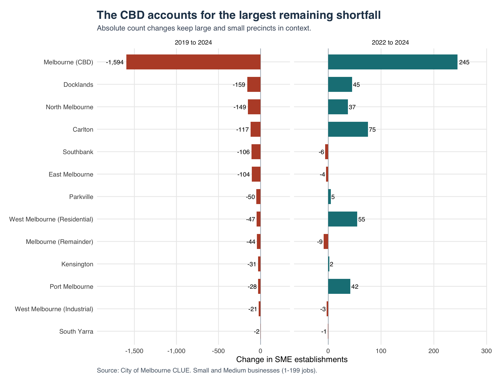
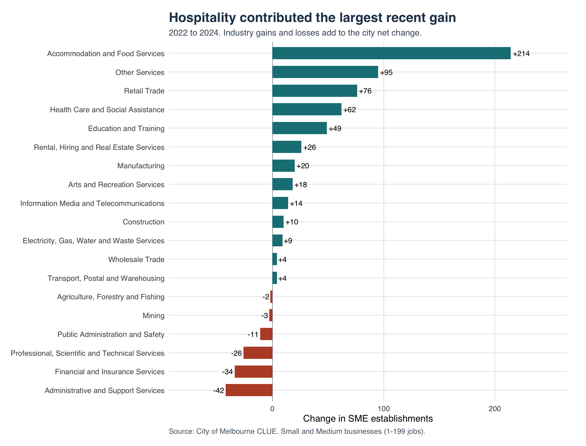
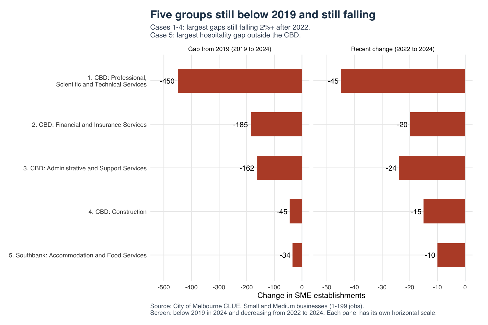
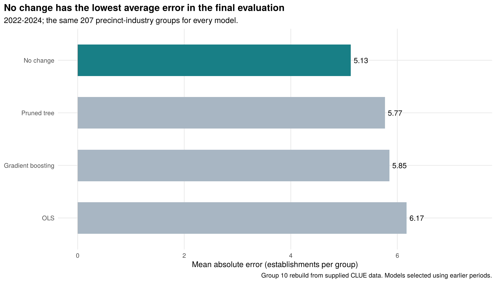
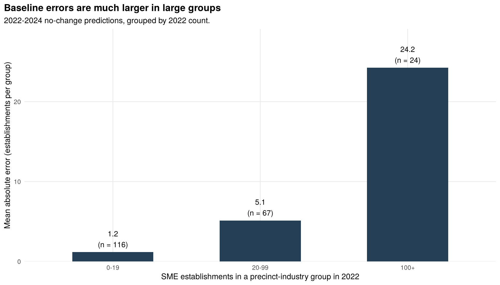
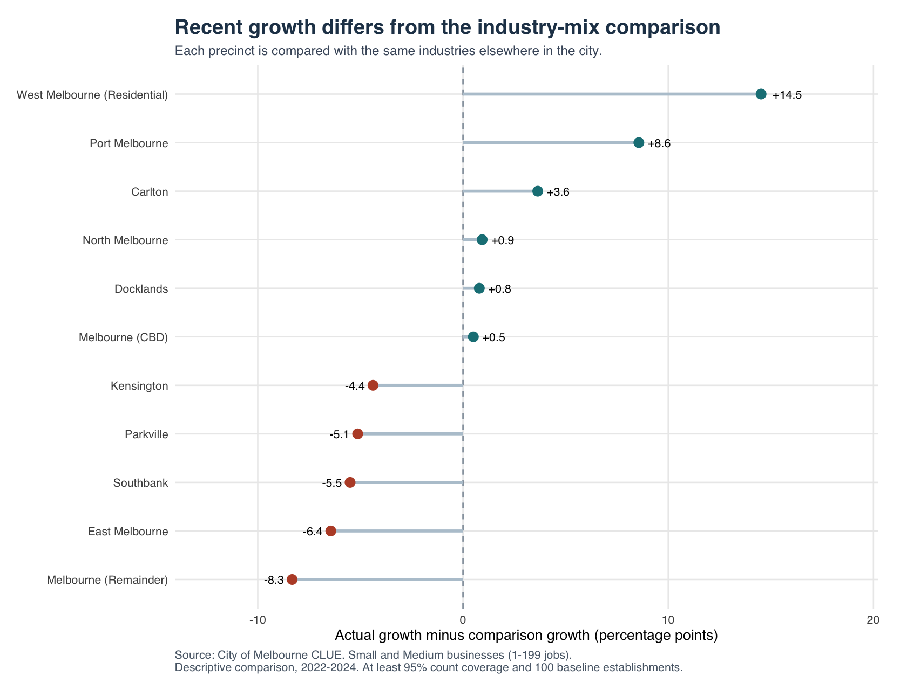

Melbourne SME recovery: where business presence remains weak
================
Group 10
21 October 2026

- [1. The question and the answer](#1-the-question-and-the-answer)
- [2. What we did with the data](#2-what-we-did-with-the-data)
  - [2.1 Coverage, variables and unit of
    analysis](#21-coverage-variables-and-unit-of-analysis)
  - [2.2 Preparation and data quality](#22-preparation-and-data-quality)
  - [2.3 Why these years and
    comparisons?](#23-why-these-years-and-comparisons)
- [3. Where recovery is happening](#3-where-recovery-is-happening)
  - [3.1 The city is growing again, but remains below
    2019](#31-the-city-is-growing-again-but-remains-below-2019)
  - [3.2 The CBD has the largest gap and the largest recent
    gain](#32-the-cbd-has-the-largest-gap-and-the-largest-recent-gain)
  - [3.3 Hospitality gains coexist with continuing service-sector
    losses](#33-hospitality-gains-coexist-with-continuing-service-sector-losses)
- [4. Five priority groups and why they
  matter](#4-five-priority-groups-and-why-they-matter)
  - [4.1 From 64 flagged groups to five specific
    cases](#41-from-64-flagged-groups-to-five-specific-cases)
  - [4.2 What each case tells the
    City](#42-what-each-case-tells-the-city)
- [5. What prediction added](#5-what-prediction-added)
- [6. Recommendations and conclusion](#6-recommendations-and-conclusion)
- [Appendix A. Predictive methods and
  diagnostics](#appendix-a-predictive-methods-and-diagnostics)
  - [A.1 Target, predictors and
    models](#a1-target-predictors-and-models)
  - [A.2 Keep later outcomes out of model
    selection](#a2-keep-later-outcomes-out-of-model-selection)
  - [A.3 Results on the 2022–2024
    evaluation](#a3-results-on-the-20222024-evaluation)
  - [A.4 Why no change performs well, and where it is
    weak](#a4-why-no-change-performs-well-and-where-it-is-weak)
  - [A.5 What changes when non-employing establishments are
    included?](#a5-what-changes-when-non-employing-establishments-are-included)
- [Appendix B. Supplementary industry-mix
  comparison](#appendix-b-supplementary-industry-mix-comparison)
- [Appendix C. Audit trail and
  reproduction](#appendix-c-audit-trail-and-reproduction)
  - [Sources and assistance](#sources-and-assistance)

<style>
body { line-height: 1.65; }
table { font-size: .9em; }
td, th { overflow-wrap: anywhere; }
pre { overflow-x: auto; }
</style>

# 1. The question and the answer

**Research question:** Which precinct–industry groups show the greatest
evidence of persistent SME weakness, and where should the City
prioritise further support?

The Lord Mayor needs evidence to focus attention across a city with
uneven business recovery. A rising city total can hide industries that
continue to lose business locations. We examine changes across precincts
and industries from 2002 to 2024, then compare the remaining gap from
2019 with recent change from 2022. This turns the broad recovery
question into a specific review list.

We use **Small and Medium establishments (1–199 jobs)** throughout. An
establishment is a business location. One company may operate several
locations.

Three findings matter:

- **Recovery remains incomplete.** The city had 13,054 SME
  establishments in 2024, 15.8% below 2019. The gain of 483 since 2022
  offset 16.5% of the earlier loss.
- **The CBD and hospitality account for much of the recent increase.**
  The CBD contributed 50.7% of the city net gain. Accommodation and Food
  Services contributed 44.3%. These describe different breakdowns of the
  same city total and should not be added together.
- **Five groups make the remaining weakness concrete.** CBD professional
  services, finance, administrative support and construction have the
  largest 2019 shortfalls among groups still falling after 2022.
  Southbank hospitality shows that the hospitality recovery has not
  reached every precinct. Together, the five account for 876 fewer
  establishments than in 2019 and a further loss of 114 after 2022.

The recommendations follow these observed patterns. Forecast comparisons
help explain why we have not used a model-generated ranking of future
recovery.

# 2. What we did with the data

## 2.1 Coverage, variables and unit of analysis

The City of Melbourne’s Census of Land Use and Employment (CLUE)
supplies two files covering 2002–2024. The aggregated file has **13,353
rows and 6 variables**: census year, precinct, ANZSIC industry division,
business size, establishment count and job count. A row is a
year–precinct–industry–size combination containing a count of
establishments. It does not represent an individual business.

Selecting Small and Medium categories retains **8,800 source rows**,
spanning 23 census years, 13 precincts and 19 industry divisions. We add
the published Small and Medium counts within each year–precinct–industry
group. For example, “CBD professional services in 2024” is one
analytical group, containing 1,338 establishments. Large and
non-employing businesses are outside the main population.

The address file contains **413,550 records and 12 fields**, including
census year, property identifiers, address, industry and coordinates. It
supports all-size count checks. It has no business-size field, so we do
not use it to identify individual SMEs or join business-level attributes
onto the SME counts.

## 2.2 Preparation and data quality

We standardised names and types, checked the grouping keys for
duplicates, and tested establishment counts for missing, negative or
non-integer values. The aggregated file passed these checks. Precinct
and industry totals were reconciled to the city total after selecting
SMEs.

Job counts are missing in **4,252 aggregated rows (31.8%)**, all
containing two or fewer establishments. This is consistent with
confidentiality suppression. Their establishment counts are available,
so we retain the rows and leave jobs missing. Jobs are not an outcome or
predictor in this analysis.

The address file includes **68,299 Vacant Space records across all
years**. We retain the original records and separate this recorded
category when checking operating-establishment totals. The aggregated
SME file has no vacancy category. This step does not identify unrecorded
closures or correct the survey cycle. The [data
audit](01_descriptive_analytics.html) records the checks and remaining
differences between the two sources.

## 2.3 Why these years and comparisons?

Two-year-or-longer comparisons follow CLUE’s two-year property survey
cycle. We use **2019 as the pre-pandemic reference, 2022 as the recent
recovery starting point and 2024 as the latest supplied year**. The city
series gives longer-term context: 11,271 SMEs in 2002, 15,515 in 2017
and 15,506 in 2019. The near-flat 2017–2019 comparison helps distinguish
the later shortfall from a long-running city-wide decline. These
comparisons describe changes around the pandemic without estimating its
causal effect.

An absent source combination stays unknown. The three-year descriptive
screen has 206 complete groups out of 217 observed in at least one
reference year. The other 11 cannot be classified by that screen. We
report counts for small groups and withhold percentage comparisons where
the relevant starting count is below 100. This is our reporting choice,
not a CLUE rule. Small groups remain in city totals.

# 3. Where recovery is happening

## 3.1 The city is growing again, but remains below 2019



The count fell by 2,935 between 2019 and 2022, then rose by 483 by 2024.
The remaining gap is 2,452 establishments. This is net change in
establishment counts, not a count of closures or a causal estimate of
COVID-19.

## 3.2 The CBD has the largest gap and the largest recent gain



All 13 precincts remained below their 2019 counts. 8 increased after
2022. The CBD accounts for 65.0% of the remaining city shortfall and
added 245 recently. Large remaining losses and recent improvement can
occur in the same precinct.

## 3.3 Hospitality gains coexist with continuing service-sector losses



Accommodation and Food Services added 214 establishments city-wide.
Industry gains totalled 601; industry losses totalled 118, leaving a net
gain of 483.

Within the CBD, hospitality increased by 180, while Professional,
Scientific and Technical Services fell by 45. CBD professional services
also had the largest precinct–industry shortfall from 2019, at 450. This
makes the industry breakdown more informative than calling the whole CBD
“recovered” or “declining”.

# 4. Five priority groups and why they matter

## 4.1 From 64 flagged groups to five specific cases

Our screen asks two questions: **Was the 2024 count below 2019? Did it
fall again between 2022 and 2024?** 64 of the 206 comparable
precinct–industry groups meet both conditions. Each group counts
business locations in one industry within one precinct.

For closer review, we rank those groups by their **absolute 2019–2024
shortfall** and keep the four largest that also fell by at least 2%
after 2022. All four are in the CBD. CBD health care ranks fourth by gap
but lost only 3 establishments after 2022 (0.9%), so it goes to a watch
list. The fifth case is the largest hospitality shortfall outside the
CBD, Southbank: hospitality drives the city’s recovery, so a hospitality
group that is still shrinking tests how far that recovery has spread.
The rule favours gaps affecting more establishments; it does not
estimate which policy would deliver the greatest benefit. The five
account for 35.7% of the city’s remaining net shortfall. Other groups
still matter: the full screen is exported, including 53 groups with a
baseline below 100 in at least one comparison.



| Precinct        | Industry                                        | 2019  | 2022  | 2024  | 2019-2024 change | 2022-2024 change |
|:----------------|:------------------------------------------------|:------|:------|:------|:-----------------|:-----------------|
| Melbourne (CBD) | Professional, Scientific and Technical Services | 1,788 | 1,383 | 1,338 | -25.2%           | -3.3%            |
| Melbourne (CBD) | Financial and Insurance Services                | 719   | 554   | 534   | -25.7%           | -3.6%            |
| Melbourne (CBD) | Administrative and Support Services             | 381   | 243   | 219   | -42.5%           | -9.9%            |
| Melbourne (CBD) | Construction                                    | 141   | 111   | 96    | -31.9%           | -13.5%           |
| Southbank       | Accommodation and Food Services                 | 236   | 212   | 202   | -14.4%           | -4.7%            |

## 4.2 What each case tells the City

**Professional, Scientific and Technical Services: the largest remaining
gap.** The count fell from 1,788 to 1,338, leaving 450 fewer
establishments than in 2019. It lost a further 45 after 2022, the
largest recent decline among these five groups. Its scale makes it the
clearest starting point for investigating weaker CBD business presence.
Growth in CBD hospitality does not offset this industry’s loss of
locations.

**Financial and Insurance Services: a second substantial service-sector
gap.** Finance fell from 719 to 534 establishments, a 25.7% reduction.
The additional loss of 20 after 2022 shows that the earlier shortfall
was still widening. Together, finance and professional services place
much of the remaining weakness in the CBD’s service economy.

**Administrative and Support Services: the deepest proportional
decline.** This group fell from 381 to 219, down 42.5%. It also lost 24
establishments after 2022 (9.9%). Its smaller size than professional
services should not obscure the much larger proportional loss. Both
scale and recent direction support keeping it near the top of the City’s
review list.

**Construction: a smaller group with the sharpest recent percentage
decline.** Construction fell from 141 to 96 establishments. Its loss of
15 since 2022 represents 13.5%, the largest recent percentage decline
among the five. The count measures construction business locations in
the CBD; it does not measure construction output or the number of
projects.

**Southbank Accommodation and Food Services: the recovery has not
reached the waterfront.** The count fell from 236 to 202, including 10
after 2022 (4.7%), while CBD hospitality grew by 180 over the same
period. Southbank’s weakness is therefore tied to the location, and a
city-wide hospitality measure would mostly reach the CBD.

# 5. What prediction added

We tested whether historical counts could improve forecasts of each
group’s next two-year change. The comparison used a no-change benchmark,
multiple linear regression, a pruned regression tree and gradient
boosting. Current count, its log transform, previous two-year change,
precinct and industry were the predictors. Even-year observations
provide consistent two-year steps aligned with the survey cycle.

Four expanding-window validation periods selected settings using mean
absolute error (MAE). Outcomes from 2024 were excluded from model
selection. Every selected model was then evaluated on the same 207
groups for 2022–2024.

| Model             | MAE (establishments per group) |
|:------------------|-------------------------------:|
| No change         |                           5.13 |
| Pruned tree       |                           5.77 |
| Gradient boosting |                           5.85 |
| OLS               |                           6.17 |

No change predicts that a group’s count stays at its starting level. It
had the lowest average error among the tested methods. In the evaluation
sample, 80.2% of groups changed by five establishments or fewer, which
helps explain why the simple benchmark was competitive. That does not
imply that the city stopped changing.

The baseline missed the matched sample’s net increase of 481
establishments, and its error was much larger for large groups. We
therefore make no model-based 2026 forecast. **Observed shortfalls and
recent changes support the recommendations.** Full model settings,
sample coverage and error diagnostics are in Appendix A.

# 6. Recommendations and conclusion

**Focus the first review on CBD professional services, finance and
administrative support.** Together they have 797 fewer establishments
than in 2019 and lost a further 89 after 2022. They combine the largest
historical gaps with continuing losses. This gives the City a specific
set of industries to consider when setting SME support priorities.

**Treat construction and Southbank hospitality separately.** CBD
construction has the sharpest recent percentage decline of the five.
Southbank hospitality is a local weakness in an industry that is growing
in the CBD. CBD health care stays on a watch list because its count has
barely moved since 2022.

**Use the precinct–industry breakdown when discussing recovery.** The
CBD added 245 SMEs overall, including 180 in hospitality, while the four
CBD cases lost 104. City growth and continuing local weakness coexist.
The same breakdown should guide consideration of the remaining screened
groups outside these five cases.

The study identifies where business presence has weakened and how the
pattern differs across groups. Choosing a particular grant, incentive or
funding amount requires evidence on business needs and intervention
costs that CLUE does not provide. Policy implementation schedules and
programme evaluation are outside this report’s scope.

# Appendix A. Predictive methods and diagnostics

## A.1 Target, predictors and models

For each precinct–industry group:

**Target change = establishments at t+2 − establishments at t.**

For example, a count of 100 rising to 108 gives a target of +8. No
change predicts a target of zero, equivalent to predicting that 100
establishments remain. Its absolute error in this example is 8.

The fitted models use five predictors available at the starting date:
the current count, log(1 + current count), the previous two-year change,
precinct and industry. The log term allows OLS to describe a curved size
relationship without forcing the effect of size to be purely
proportional.

- **No change:** a simple benchmark with no fitted coefficients.
- **Multiple linear regression (OLS):** a transparent additive
  relationship between the predictors and the next change.
- **Pruned regression tree:** thresholds and interactions, with pruning
  chosen from historical validation rather than random cross-validation.
- **Gradient boosting:** a small ensemble of shallow regression trees,
  tested to see whether added flexibility improves prediction.

Every method is assessed on identical cells. Predicted changes are
bounded below by minus the starting count, so a forecast cannot imply a
negative number of establishments. Predictions are not rounded before
scoring.

## A.2 Keep later outcomes out of model selection

We grow the training window forward through time. For a prediction made
at year t, training can use only changes whose **outcome year is at or
before t**. The train/test separation applies to time, not a random
selection of rows.

| Training origins | Last observed training outcome | Validation period | Training rows |
|:-----------------|-------------------------------:|:------------------|--------------:|
| 2004-2012        |                           2014 | 2014-2016         |          1042 |
| 2004-2014        |                           2016 | 2016-2018         |          1247 |
| 2004-2016        |                           2018 | 2018-2020         |          1450 |
| 2004-2018        |                           2020 | 2020-2022         |          1657 |

The tree grid tests pruning parameters 0.001, 0.01 and 0.05, with
minimum leaf sizes of 5 or 10. Boosting tests depths 1 or 2 and 100 or
300 trees, with a learning rate of 0.03. No random subsampling is used.

We average the four validation MAEs, giving each historical period equal
weight. That selects a configuration within each model family and an
overall model **before** the 2022–2024 evaluation. The selected model is
**No change**. These are reconstructed historical tests using the
supplied data vintage, not a prospective test on newly observed
outcomes.

## A.3 Results on the 2022–2024 evaluation

| Model             | Cells |  MAE |  RMSE | Mean error | Selected before test |
|:------------------|------:|-----:|------:|-----------:|:---------------------|
| No change         |   207 | 5.13 | 15.45 |      -2.32 | TRUE                 |
| Pruned tree       |   207 | 5.77 | 20.91 |      -3.26 | FALSE                |
| Gradient boosting |   207 | 5.85 | 22.22 |      -4.04 | FALSE                |
| OLS               |   207 | 6.17 | 20.22 |      -4.34 | FALSE                |

MAE is the average absolute error, in establishments per group. RMSE
gives large errors more weight. Mean error is predicted minus actual
change: negative values indicate underprediction.



The evaluation includes 207 of 210 published starting groups and 100.0%
of their establishments. The matched sample gained 481 establishments,
compared with 483 for the city. Coverage tables account for the
difference; it is not silently treated as zero.

The baseline wins on test MAE and RMSE in this rebuild. Historical
validation RMSE and MAE do not always rank models in the same order; the
model-selection rule was MAE throughout. The complete validation
leaderboard is exported.

## A.4 Why no change performs well, and where it is weak

80.2% of evaluation groups changed by five establishments or fewer.
56.0% started with fewer than 20 establishments. Predicting zero can
keep errors small across many such groups without estimating extra
relationships.

That is a pattern in the evaluation sample, not proof that every group
is stable. Only 21.3% had exactly zero change. Large changes still
matter.



The ten largest errors account for 45.9% of total absolute error. The
no-change prediction misses the matched sample’s net gain of 481. We
therefore use it as a benchmark, while using observed local gaps and
recent changes to support investigation priorities. A zero-change
forecast cannot rank which groups will recover fastest.

## A.5 What changes when non-employing establishments are included?

| Scope                          | Model             | Matched cells |  MAE |  RMSE | Observed net change |
|:-------------------------------|:------------------|--------------:|-----:|------:|--------------------:|
| Small + Medium                 | Gradient boosting |           207 | 5.85 | 22.22 |                 481 |
| Small + Medium                 | No change         |           207 | 5.13 | 15.45 |                 481 |
| Small + Medium                 | OLS               |           207 | 6.17 | 20.22 |                 481 |
| Small + Medium                 | Pruned tree       |           207 | 5.77 | 20.91 |                 481 |
| Small + Medium + Non employing | Gradient boosting |           207 | 5.84 | 21.14 |                 458 |
| Small + Medium + Non employing | No change         |           207 | 5.12 | 14.94 |                 458 |
| Small + Medium + Non employing | OLS               |           207 | 6.26 | 19.64 |                 458 |
| Small + Medium + Non employing | Pruned tree       |           207 | 6.13 | 22.19 |                 458 |

This check holds each model family’s main-analysis configuration fixed
and compares identical group keys. It changes the population, so its
counts and error sizes should not replace the main results. The separate
data audit compares descriptive results under both definitions.

# Appendix B. Supplementary industry-mix comparison

We compare each precinct with the **same industries elsewhere in the
city**. For each matched industry, we multiply the local starting count
by the rest-of-city industry’s observed growth factor. We then sum the
comparison counts over the same cells as the observed counts.



A negative value means local growth was below that descriptive
comparison. It suggests a question for local investigation without
estimating the effect of a precinct, COVID-19 or a policy. It is
supplementary to the five-case selection and does not determine that
ranking.

The chart requires at least 95% count coverage in both years and a
starting count of 100. These are our reporting thresholds. The exported
tables also repeat the comparison after requiring 100 establishments in
each rest-of-city reference industry, to check sensitivity to small
reference groups.

# Appendix C. Audit trail and reproduction

The report is generated from R Markdown, which runs the calculations and
inserts the resulting tables and figures. The supplied CSV files remain
unchanged. Source checksums, package versions and test results are saved
with the analysis outputs.

Run from the repository root:

``` sh
Rscript scripts/install_dependencies.R
Rscript scripts/run_final_analysis.R
```

The first command installs missing packages once. The second runs both
test suites and rebuilds the data audit, final analysis, charts and
exported results. No packages or source datasets are downloaded during
analysis.

The code checks duplicate keys, invalid counts, source-file hashes,
missing cells, reconciliation, identical evaluation samples, exact
two-year alignment, and temporal leakage. A test changes the held-out
outcomes and confirms that all four models’ predictions remain
unchanged.

Key files:

- `scripts/descriptive_followup.R`: counts, contributions, industry-mix
  comparison and observed review lists.
- `scripts/predictive_models.R`: panel construction, validation, fitting
  and errors.
- `tests/test_final_analysis.R`: independent calculations and
  failure-case tests.
- `outputs/tables/final/`: every score, prediction, exclusion, setting
  and figure.

The report uses the supplied 2002–2024 snapshot. It does not estimate
individual business survival, policy effects, employment growth or the
causal effect of COVID-19. There are only four validation periods and
one final evaluation period. The error rankings do not establish
statistical significance.

## Sources and assistance

City of Melbourne: [aggregated CLUE
dataset](https://discover.data.vic.gov.au/dataset/business-establishments-and-jobs-data-by-business-size-and-anzsic-in-small-areas)
and [address-level
dataset](https://discover.data.vic.gov.au/dataset/business-establishments-location-and-industry-classification).
The supplied files, rather than live downloads, are used here.

Hyndman and Athanasopoulos, [*Forecasting: Principles and Practice*,
Chapter 5](https://otexts.com/fpp3/toolbox.html): naive benchmarks,
forecast errors and rolling-origin evaluation. [rpart
documentation](https://cran.r-project.org/package=rpart) and [gbm
documentation](https://cran.r-project.org/package=gbm) describe the
fitted tree methods.

Claude (Anthropic) reviewed and extended the R code and edited the data
sections. Codex (OpenAI) reviewed earlier versions of the R scripts. See
`docs/AI_ASSISTANCE.md`. The group is responsible for the submission.

    ## R version 4.3.3 (2024-02-29)
    ## Platform: x86_64-pc-linux-gnu (64-bit)
    ## Running under: Ubuntu 24.04.5 LTS
    ## 
    ## Matrix products: default
    ## BLAS:   /usr/lib/x86_64-linux-gnu/blas/libblas.so.3.12.0 
    ## LAPACK: /usr/lib/x86_64-linux-gnu/lapack/liblapack.so.3.12.0
    ## 
    ## locale:
    ##  [1] LC_CTYPE=C.UTF-8       LC_NUMERIC=C           LC_TIME=C.UTF-8       
    ##  [4] LC_COLLATE=C.UTF-8     LC_MONETARY=C.UTF-8    LC_MESSAGES=C.UTF-8   
    ##  [7] LC_PAPER=C.UTF-8       LC_NAME=C              LC_ADDRESS=C          
    ## [10] LC_TELEPHONE=C         LC_MEASUREMENT=C.UTF-8 LC_IDENTIFICATION=C   
    ## 
    ## time zone: Australia/Melbourne
    ## tzcode source: system (glibc)
    ## 
    ## attached base packages:
    ## [1] stats     graphics  grDevices utils     datasets  methods   base     
    ## 
    ## other attached packages:
    ##  [1] knitr_1.45      scales_1.3.0    lubridate_1.9.3 forcats_1.0.0  
    ##  [5] stringr_1.5.1   dplyr_1.1.4     purrr_1.0.2     readr_2.1.5    
    ##  [9] tidyr_1.3.1     tibble_3.2.1    ggplot2_3.4.4   tidyverse_2.0.0
    ## 
    ## loaded via a namespace (and not attached):
    ##  [1] sass_0.4.8        utf8_1.2.4        generics_0.1.3    stringi_1.8.3    
    ##  [5] lattice_0.22-5    hms_1.1.3         digest_0.6.34     magrittr_2.0.3   
    ##  [9] evaluate_0.23     grid_4.3.3        timechange_0.3.0  gbm_2.1.8.1      
    ## [13] fastmap_1.1.1     jsonlite_1.8.8    Matrix_1.6-5      survival_3.5-8   
    ## [17] fansi_1.0.5       textshaping_0.3.7 jquerylib_0.1.4   cli_3.6.2        
    ## [21] crayon_1.5.2      rlang_1.1.3       bit64_4.0.5       munsell_0.5.0    
    ## [25] splines_4.3.3     withr_2.5.0       cachem_1.0.8      yaml_2.3.8       
    ## [29] parallel_4.3.3    tools_4.3.3       tzdb_0.4.0        colorspace_2.1-0 
    ## [33] vctrs_0.6.5       R6_2.5.1          rpart_4.1.23      lifecycle_1.0.4  
    ## [37] bit_4.0.5         vroom_1.6.5       ragg_1.2.7        pkgconfig_2.0.3  
    ## [41] pillar_1.9.0      bslib_0.6.1       gtable_0.3.4      glue_1.7.0       
    ## [45] systemfonts_1.0.5 highr_0.10        xfun_0.41         tidyselect_1.2.0 
    ## [49] farver_2.1.1      htmltools_0.5.7   labeling_0.4.3    rmarkdown_2.25   
    ## [53] compiler_4.3.3
