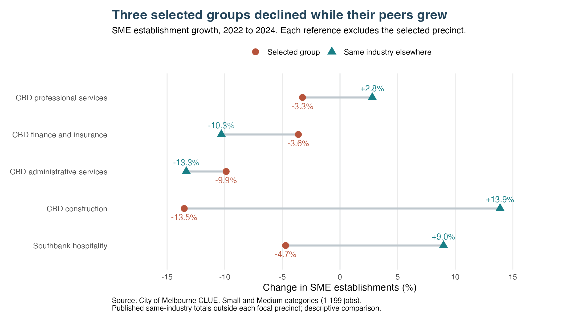
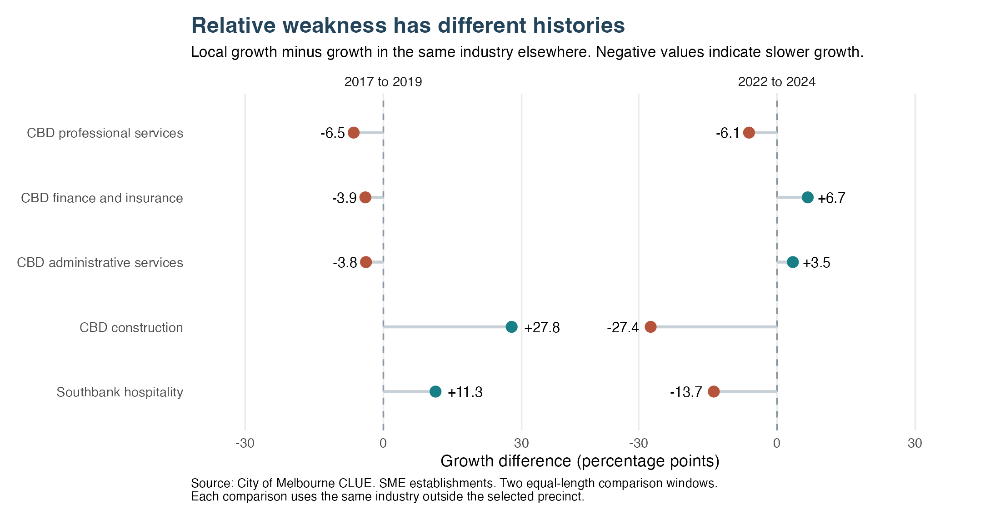
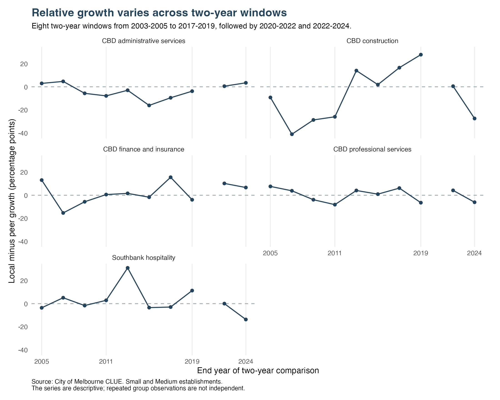

SME recovery: comparing the five cases with industry peers
================
Group 10
23 October 2026

- [1. What this adds to the report](#1-what-this-adds-to-the-report)
- [2. Data and comparison method](#2-data-and-comparison-method)
- [3. Recent change: three distinct local
  gaps](#3-recent-change-three-distinct-local-gaps)
- [4. Was relative weakness already present before
  2020?](#4-was-relative-weakness-already-present-before-2020)
- [5. How much do the cases depend on our
  choices?](#5-how-much-do-the-cases-depend-on-our-choices)
  - [Recent-decline cutoff](#recent-decline-cutoff)
  - [Baseline year](#baseline-year)
  - [Peer composition](#peer-composition)
- [6. What this means for the report](#6-what-this-means-for-the-report)
- [7. Reproducibility](#7-reproducibility)

# 1. What this adds to the report

The five cases all lost SME establishments between 2022 and 2024. The
next question is whether the same industries also lost establishments
elsewhere. That distinction changes the reason for selecting each case
for closer review.

Three groups declined while their industry peers grew: **CBD
professional services, CBD construction and Southbank hospitality**. CBD
finance and administrative services also declined, but less sharply than
their peers. Their importance comes from the size of their remaining
historical gaps.

The comparisons describe differences in business presence. They do not
measure the effect of COVID or predict the effect of a support
programme.

# 2. Data and comparison method

We use the supplied CLUE file
`business-establishments-and-jobs-data-by-business-size-and-anzsic.csv`.
Small and Medium business categories are summed within each census year,
precinct and ANZSIC division. These categories cover establishments with
1–199 jobs. Missing job counts do not affect the establishment totals.

For each case, its reference is the **same industry in all other
precincts**. The focal precinct is excluded so it cannot influence its
own benchmark. We pool the counts before calculating growth: a precinct
with one business does not receive the same weight as one with hundreds.

``` r
# An example using the CBD professional-services case, 2022 to 2024.
# These quantities are rebuilt from the raw source by run_peer_review().
example <- recent[recent$case_rank == 1, ]
peer_growth <- example$peer_end / example$peer_start - 1
benchmark_count <- example$n_start * (1 + peer_growth)
observed_minus_benchmark <- example$n_end - benchmark_count
```

The CBD had 1,383 professional-services SMEs in 2022. Applying the +2.8%
growth of professional services outside the CBD gives a comparison count
of about 1,422 in 2024. The observed count was 1,338, about 84 below
that reference. The reference is a descriptive calculation, not a
forecast or an estimate of businesses lost because of a particular
policy or event.

Comparisons use years at least two years apart. An absent
precinct–industry–year cell stays unknown. Published peer totals are
accompanied by a matched-peer check using only precincts observed in
both years.

# 3. Recent change: three distinct local gaps



| Group | Local growth | Peer growth | Difference | Observed minus benchmark |
|:---|:---|:---|:---|:---|
| CBD professional services | -3.3% | +2.8% | -6.1 pp | -83.8 |
| CBD finance and insurance | -3.6% | -10.3% | +6.7 pp | +37.0 |
| CBD administrative services | -9.9% | -13.3% | +3.5 pp | +8.4 |
| CBD construction | -13.5% | +13.9% | -27.4 pp | -30.4 |
| Southbank hospitality | -4.7% | +9.0% | -13.7 pp | -29.0 |

The professional-services gap combines a large existing sector with
recent underperformance. Construction has the widest percentage-point
difference, but starts from a smaller count. Southbank hospitality moves
in the opposite direction to hospitality elsewhere. Finance and
administrative services need a different explanation: their decline is
shared across precincts, and the CBD performed relatively better during
this recent period.

The five cases together remain 876 SMEs below their 2019 counts. Their
114 net loss since 2022 is part of that historical gap; the two numbers
must not be added together.

# 4. Was relative weakness already present before 2020?



CBD professional services grew more slowly than peers in both 2017–2019
(-6.5 pp) and 2022–2024 (-6.1 pp). This recent gap is not entirely new.
Construction and Southbank hospitality were ahead of peers in the
earlier window and behind them in the recent one.

Earlier windows give a mixed picture. Professional services
underperformed in only three of eight non-overlapping pre-period
comparisons from 2003–2005 to 2017–2019, and outperformed peers in
2020–2022. The alternate even-year pre-period scheme gives five of eight
underperformances. We therefore describe weakness in the two selected
windows without claiming an uninterrupted historical trend or a
permanent structural break.



# 5. How much do the cases depend on our choices?

## Recent-decline cutoff

The four scale cases are the largest 2019–2024 shortfalls among groups
that also declined by at least 2% in 2022–2024. The fifth case is
selected separately: the largest hospitality shortfall outside the CBD
among continuing declines.

The same four scale cases appear with a 1%, 2% or 3% recent-decline
cutoff. At 0%, CBD health care replaces construction. At 5%, only two of
the four original scale cases remain. The 2% cutoff is a practical
case-selection choice, not a test of statistical significance.

| Recent decline cutoff | Original four retained | Same four cases |
|:----------------------|:-----------------------|:----------------|
| 0%                    | 3/4                    | No              |
| 1%                    | 4/4                    | Yes             |
| 2%                    | 4/4                    | Yes             |
| 3%                    | 4/4                    | Yes             |
| 5%                    | 2/4                    | No              |

## Baseline year

Using 2018 changes the shortlist. North Melbourne professional services
replaces CBD construction, and Docklands replaces Southbank as the
hospitality contrast. The first three CBD cases remain. All original
five still have fewer SMEs in 2024 than in either baseline year, but
their ranking and gap sizes depend on that choice.

| Group | 2018 count | 2019 count | 2024 count | Change from 2018 | Change from 2019 |
|:---|---:|---:|---:|:---|:---|
| CBD professional services | 1822 | 1788 | 1338 | -26.6% | -25.2% |
| CBD finance and insurance | 720 | 719 | 534 | -25.8% | -25.7% |
| CBD administrative services | 391 | 381 | 219 | -44.0% | -42.5% |
| CBD construction | 126 | 141 | 96 | -23.8% | -31.9% |
| Southbank hospitality | 206 | 236 | 202 | -1.9% | -14.4% |

This matters most for Southbank hospitality: 2024 is just 1.9% below
2018, compared with 14.4% below 2019. Its recent underperformance
remains, but the size of its historical shortfall should be tied
explicitly to the 2019 baseline. The complete alternative roster is
exported in `baseline_case_selection.csv`.

## Peer composition

Excluding the CBD as well as Southbank still leaves hospitality peers
growing by +4.7%, compared with Southbank’s -4.7%. The local divergence
is not explained solely by a strong CBD rebound.

Construction has one establishment in a newly observed peer cell in
2024. Using only peer precincts observed in both years reduces peer
growth from 13.9% to 13.3%. It does not change the conclusion. Every
exported comparison includes peer coverage and matched-peer growth so
this can be checked directly.

# 6. What this means for the report

Use the peer comparison to explain **why** each case is important.
Professional services, construction and Southbank hospitality show local
underperformance against growing peers. Finance and administrative
services show large remaining gaps within industries that also declined
elsewhere.

This supports differentiated priorities for further investigation. It
does not establish the causes of the gaps, identify individual business
closures, or show which intervention would work. Those claims need
additional evidence.

# 7. Reproducibility

The supplement is built by `scripts/07_peer_comparison_review.R`; it can
also be sourced and run as `run_peer_review(root, make_figures = TRUE)`.
Tables and figures are written under `outputs/*/final/deeper_review/`.
The source checksum and R session details are saved alongside them. The
raw file is unchanged.

`tests/test_peer_comparison_review.R` independently recomputes
comparisons, rankings and history from the raw CSV, and checks
missing-cell behaviour, zero denominators and the two-year comparison
rule. Run it with:

``` r
# From the repository root, in a terminal:
# Rscript tests/test_peer_comparison_review.R
```

``` r
sessionInfo()
```

    ## R version 4.5.3 (2026-03-11)
    ## Platform: aarch64-apple-darwin20
    ## Running under: macOS 27.0.1
    ## 
    ## Matrix products: default
    ## BLAS:   /Library/Frameworks/R.framework/Versions/4.5-arm64/Resources/lib/libRblas.0.dylib 
    ## LAPACK: /Library/Frameworks/R.framework/Versions/4.5-arm64/Resources/lib/libRlapack.dylib;  LAPACK version 3.12.1
    ## 
    ## locale:
    ## [1] C.UTF-8/C.UTF-8/C.UTF-8/C/C.UTF-8/C.UTF-8
    ## 
    ## time zone: Australia/Melbourne
    ## tzcode source: internal
    ## 
    ## attached base packages:
    ## [1] stats     graphics  grDevices utils     datasets  methods   base     
    ## 
    ## other attached packages:
    ##  [1] knitr_1.51      scales_1.4.0    lubridate_1.9.5 forcats_1.0.1  
    ##  [5] stringr_1.6.0   dplyr_1.2.0     purrr_1.2.1     readr_2.2.0    
    ##  [9] tidyr_1.3.2     tibble_3.3.1    ggplot2_4.0.2   tidyverse_2.0.0
    ## 
    ## loaded via a namespace (and not attached):
    ##  [1] sass_0.4.10        generics_0.1.4     stringi_1.8.7      lattice_0.22-9    
    ##  [5] hms_1.1.4          digest_0.6.39      magrittr_2.0.4     timechange_0.4.0  
    ##  [9] evaluate_1.0.5     grid_4.5.3         RColorBrewer_1.1-3 gbm_2.3.1         
    ## [13] fastmap_1.2.0      jsonlite_2.0.0     Matrix_1.7-4       survival_3.8-6    
    ## [17] textshaping_1.0.5  jquerylib_0.1.4    cli_3.6.5          crayon_1.5.3      
    ## [21] rlang_1.1.7        bit64_4.6.0-1      splines_4.5.3      withr_3.0.2       
    ## [25] cachem_1.1.0       yaml_2.3.12        otel_0.2.0         parallel_4.5.3    
    ## [29] tools_4.5.3        tzdb_0.5.0         vctrs_0.7.1        R6_2.6.1          
    ## [33] rpart_4.1.24       lifecycle_1.0.5    bit_4.6.0          vroom_1.7.0       
    ## [37] ragg_1.5.1         pkgconfig_2.0.3    bslib_0.10.0       pillar_1.11.1     
    ## [41] gtable_0.3.6       glue_1.8.0         systemfonts_1.3.2  xfun_0.56         
    ## [45] tidyselect_1.2.1   farver_2.1.2       htmltools_0.5.9    labeling_0.4.3    
    ## [49] rmarkdown_2.30     compiler_4.5.3     S7_0.2.1
