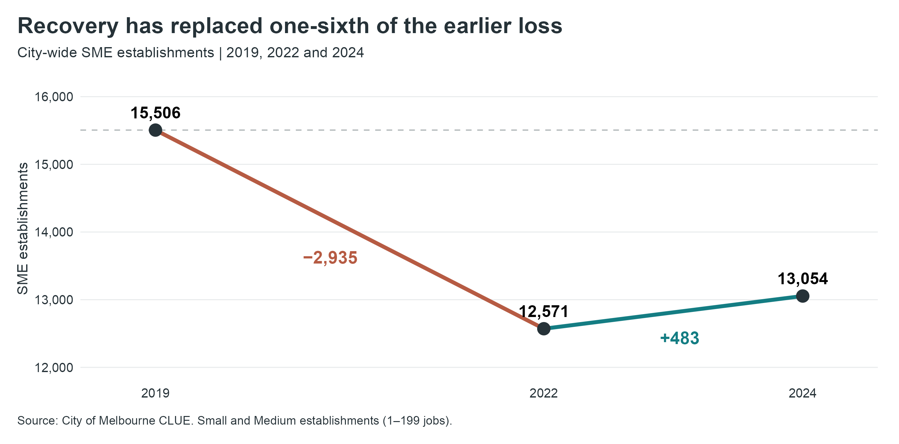
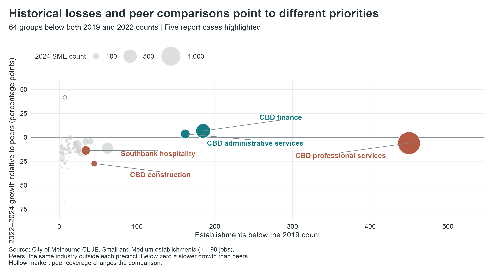
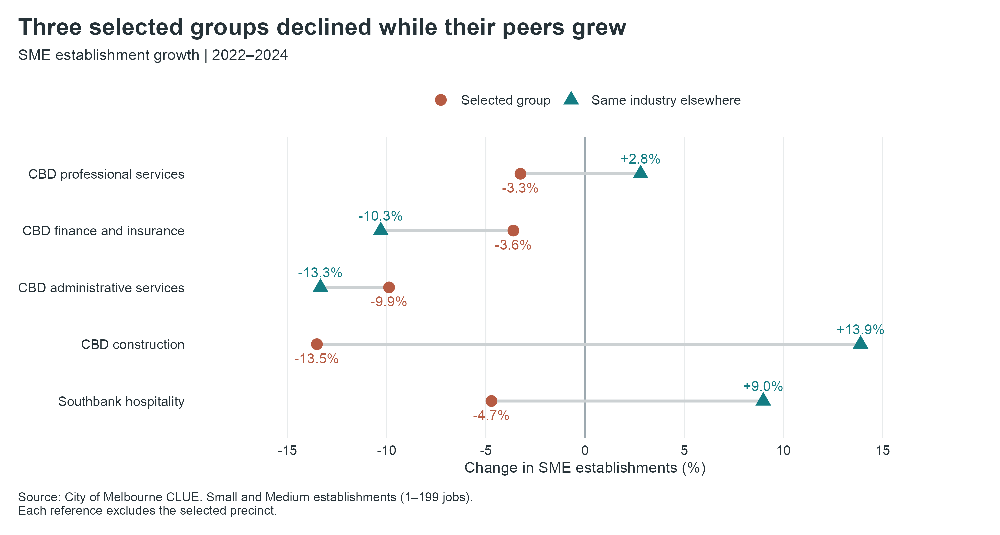
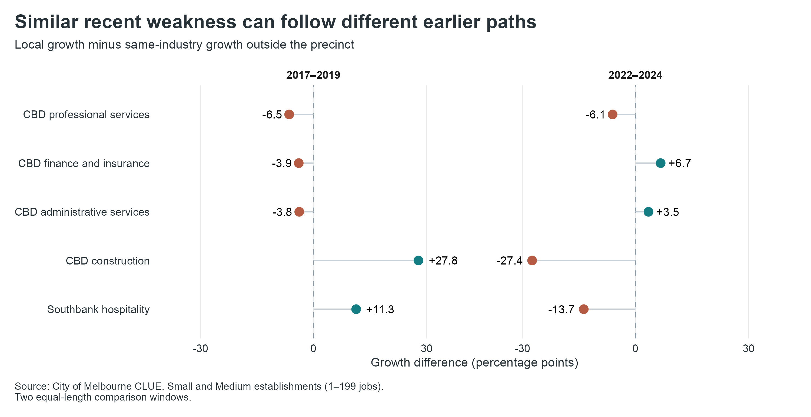
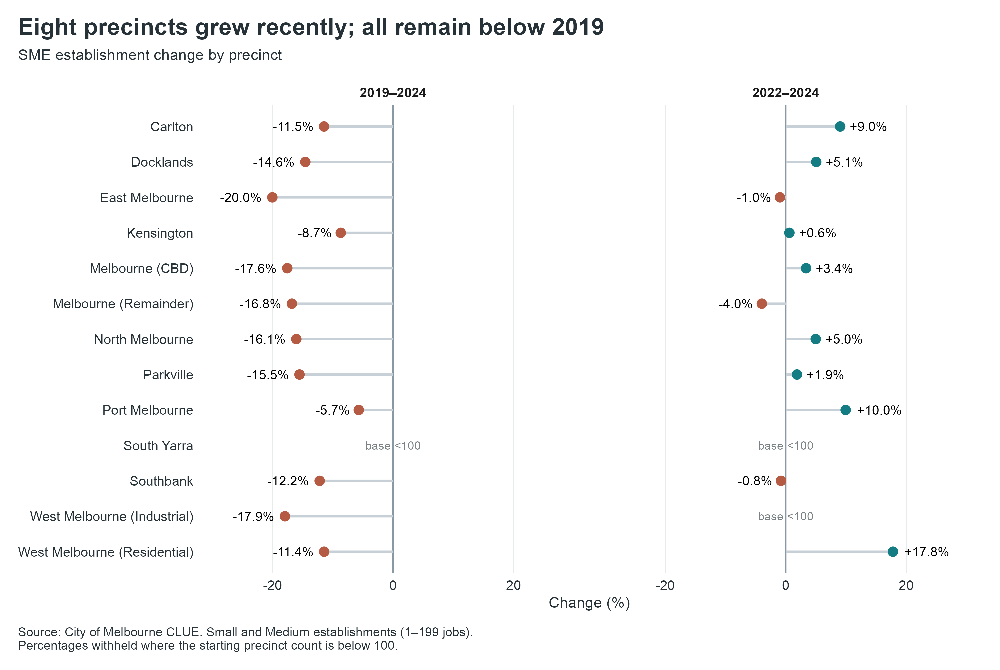
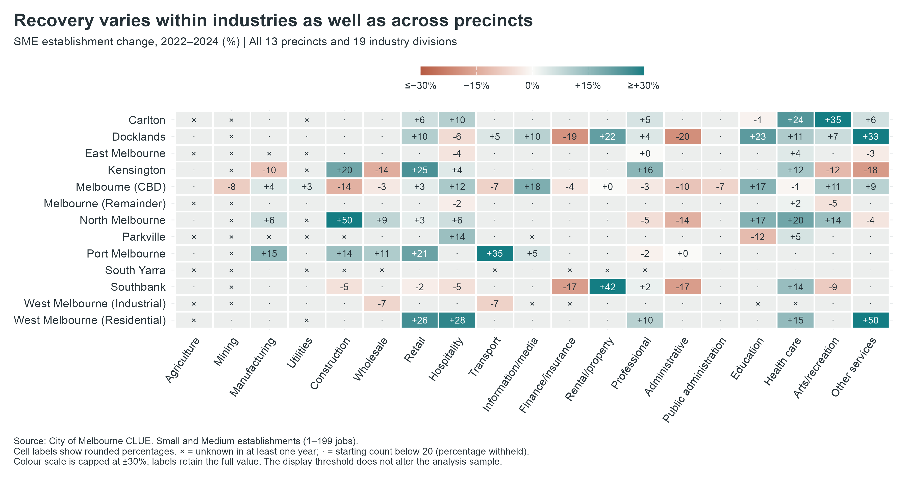

# Melbourne SME Establishments and Recovery

Final Report | Group 10 | CMCE30005 Business Analytics Challenge

Yixi Wang | Wayne Cao | Angelyne Leang | Megan Suprapto  
23 October 2026

## 1 Introduction

Melbourne’s small and medium-sized enterprises (SMEs) have regained establishments since 2022, yet some precinct–industry groups continue to shrink. The Lord Mayor needs to decide where business consultation and support deserve priority. City-wide growth can conceal losses among the smaller operators these measures are intended to reach.

The City’s Economic Development Strategy 2031 links reduced office attendance and visitor activity to disrupted demand (City of Melbourne, 2021, pp. 12–14). Using Census of Land Use and Employment (CLUE) data, we examine persistent shortfalls and compare local recovery with industry peers.

## 2 Problem Definition and Objectives

Which precinct–industry groups in Melbourne show persistent SME establishment shortfalls, and how can their historical and recent recovery patterns inform priorities for further investigation and potential support?

Our objectives are to measure remaining losses against 2019 and recovery since 2022, identify groups with substantial continuing declines, and test whether forecasts improve decision support. Same-industry comparisons distinguish local underperformance from broader sector weakness.

| Dimension | Scope |
| --- | --- |
| Population | Small (1–19 jobs) and Medium (20–199 jobs). Non-employing and Large excluded. |
| Coverage | 13 CLUE small areas and 19 ANZSIC divisions, 2002–2024. |
| Comparisons | 2019 baseline; 2022–2024 recovery. No annual growth or entry/exit rates. |
| Outcome | Establishment counts. Firm survival, employment growth and causal effects outside scope. |

Table 1. Scope of the analysis. One firm can operate at multiple locations.

## 3 Data Description

The aggregated CLUE file contains 13,353 rows and six variables: year, precinct, industry, business size, establishment count and job count (City of Melbourne, n.d.-a). Each row represents a year–precinct–industry–size combination. Selecting Small and Medium retains 8,800 rows. The 413,550-record address file has no size field and supports all-size cross-checks (City of Melbourne, n.d.-b).

We standardised names and types and checked missingness, duplicate keys and invalid counts. Establishment counts are complete. Jobs are missing in 4,252 rows (31.8%), all containing at most two establishments, consistent with confidentiality suppression. We retained these rows without imputing jobs, preserving establishment coverage.

The address file’s 68,299 Vacant Space observations are a recorded category, not missing values. They remain in source data and are excluded only from operating-establishment cross-checks. The aggregated SME file has no vacancy category.

Group totals reconcile to city totals. Descriptive comparisons use 206 groups observed in 2019, 2022 and 2024; 100 had fewer than 20 establishments in 2019. Prediction requires 2020, 2022 and 2024 counts for its lag, starting level and target (207 groups). Unpublished cells remain unknown. Appendix B shows geographic and industry distributions. This uneven size distribution makes both absolute losses and proportional change useful, while discouraging rankings driven by tiny baselines.

## 4 Methodology and Analytical Approach

R and R Markdown reproduce checks, tables and ggplot2 figures. We compare 2019–2024 shortfalls and 2022–2024 recovery. CLUE’s two-year property survey cycle supports multi-year comparisons (City of Melbourne, n.d.-c). Even-year predictive origins, 2004–2022, give non-overlapping two-year change windows; they do not make repeated groups independent.

We flag counts below both 2019 and 2022, then select the four largest historical shortfalls among groups declining at least 2% after 2022. This focuses on material continuing declines. The non-CBD hospitality group with the largest shortfall among continuing declines adds a contrast within a recovering industry.

Peers are the same industry outside each case’s precinct. Starting count multiplied by one plus peer growth gives a benchmark for relative performance. Earlier periods, alternative decline cutoffs and a 2018 baseline test the comparisons and case selection.

Models predict two-year changes using current count, log(1 + count), previous change, precinct and industry. Modelling change focuses on growth beyond the starting level. Linear regression (OLS) tests linear relationships; a pruned regression tree captures thresholds and interactions; gradient boosting tests greater flexibility. No-change carries the latest count forward, predicting zero change (Hyndman & Athanasopoulos, 2021).

We assume comparable classifications and test whether historical relationships carry forward. Four expanding-window folds predict 2016, 2018, 2020 and 2022. Mean absolute error (MAE), averaged across folds, selects configurations before the separate 2022–2024 test. Root mean squared error (RMSE) gives large errors more weight. The 207 test groups cover over 99.9% of city counts; group-size and aggregate errors assess decision usefulness.

## 5 Analysis and Results

### 5.1 Recovery has replaced only a small part of the loss

SME establishments fell from 15,506 in 2019 to 12,571 in 2022, then rose to 13,054 in 2024. The gain of 483 (+3.8%) recovered 16.5% of the earlier loss. The remaining shortfall is 2,452 establishments, or 15.8% of the 2019 count.

Figure 1. City-wide SME establishments, 2019–2024.

### 5.2 Recovery differs across precincts

All 13 precincts remain below 2019; eight grew after 2022. The CBD added 245 establishments, half the city gain, yet holds 1,594 of the remaining 2,452 shortfall. East Melbourne has the largest percentage gap (20.0%), distinguishing proportional decline from the CBD’s larger absolute loss.

Applying outside-CBD industry growth rates to its 2019 counts gives a benchmark of 7,663 against 7,485 observed in 2024. About 89% of the CBD’s fall matches the decline implied by these rates, showing substantial weakness shared with its industries elsewhere.

### 5.3 Hospitality growth coexists with continuing service-sector losses

Professional services, finance and administration account for 48% of the historical net loss and continued to decline after 2022. Professional services lost another 26 establishments, while retail regained 76. Historical shortfalls therefore do not always signal continuing deterioration.

Hospitality added 214 establishments, 44% of the recent net gain. Across industries, gains of 601 were offset by losses of 118. Recovery is concentrated in growing sectors while several service industries continue to shrink.

### 5.4 Five groups for closer attention

The screen flags 64 groups; 53 had fewer than 100 establishments in at least one baseline year. Our five cases account for 876 lost establishments since 2019, or 35.7% of the city’s shortfall (Table 2).

These cases lost another 114 establishments after 2022 while all other groups gained 597. CBD health care fell only 0.9%, below our 2% cutoff; Southbank adds a non-CBD comparison. CBD retail illustrates the distinction: despite a 298-establishment historical shortfall, it added 37 after 2022 and is excluded. Historical scale alone therefore does not determine the shortlist.

Figure 2. The 64 screened groups. Bubble area represents 2024 SME counts.

Figure 3 compares each case with its industry peers.

| Group | 2019 | 2022 | 2024 | 2019–24 change | 2022–24 change |
| --- | --- | --- | --- | --- | --- |
| CBD professional services | 1,788 | 1,383 | 1,338 | -450 | -45 |
| CBD finance and insurance | 719 | 554 | 534 | -185 | -20 |
| CBD administrative services | 381 | 243 | 219 | -162 | -24 |
| CBD construction | 141 | 111 | 96 | -45 | -15 |
| Southbank hospitality | 236 | 212 | 202 | -34 | -10 |

Table 2. SME counts. Hospitality refers to Accommodation and Food Services.

Figure 3. Local and same-industry peer growth, 2022–2024.

CBD professional services has the largest shortfall: 450 establishments, including 428 Small establishments. Its recent decline of 3.3% contrasts with peer growth of 2.8%. CBD construction fell 13.5% against peer growth of 13.9%; its entire historical loss of 45 is in the Small category.

Southbank hospitality fell 4.7% while peers grew 9.0%. Excluding the CBD still leaves peer growth of 4.7%, extending the contrast beyond one large precinct. Its weakness warrants local investigation within a recovering industry.

CBD finance and administration fell 3.6% and 9.9%, while peers fell faster: 10.3% and 13.3%. Wider sector decline matters here. Finance’s Small category lost 204 establishments from 2019 while Medium gained 19, concentrating the historical loss among smaller operators.

### 5.5 Earlier comparisons put recent weakness in context

CBD professional services already lagged peers in 2017–2019: it fell 3.5% while peers grew 2.9%. Southbank hospitality then grew 14.6% against peers’ 3.2%, before declining during the recent recovery. Figure A1 distinguishes weakness visible before COVID from a reversal in local performance.

### 5.6 Testing the case selection

The four core cases remain at 1%, 2% and 3% decline cutoffs. A 2018 baseline retains CBD professional services, finance and administration; North Melbourne professional services and Docklands hospitality replace construction and Southbank. The latter two remain informative contrasts, but their selection depends more on the baseline.

### 5.7 Predictive models do not improve on the benchmark

No-change wins on validation MAE and both test measures (Table 3). The tree and OLS have slightly lower validation RMSE. Selection follows the prespecified MAE criterion.

| Model | Validation MAE | Validation RMSE | Test MAE | Test RMSE |
| --- | --- | --- | --- | --- |
| No change | 6.95 | 20.04 | 5.13 | 15.45 |
| Pruned tree | 7.44 | 19.46 | 5.77 | 20.91 |
| Gradient boosting | 7.30 | 20.73 | 5.85 | 22.22 |
| OLS | 7.42 | 19.88 | 6.17 | 20.22 |

Table 3. Prediction errors in establishments per group. Lower values are better.

Around 80% of test groups changed by five or fewer establishments, favouring no-change. Its MAE rises from 5.13 overall to 24.25 for the 24 groups starting with at least 100 establishments. The CBD contributes 91% of squared error.

The matched sample gained 481 establishments, compared with 483 city-wide. No-change predicted zero; fitted models predicted losses of 193–418. Their historical relationships failed to capture the rebound. We therefore issue no 2026 forecast.

## 6 Key Findings and Recommendations

### 6.1 Key findings

Recovery remains incomplete and uneven. Only 16.5% of the earlier loss has been recovered, and the CBD holds 65% of the remaining shortfall. Hospitality drives much of the rebound while several service industries continue to contract.

The five cases explain 35.7% of the remaining gap and kept shrinking while other groups grew. Figure 3 separates three locally weak cases from two sharing wider sector decline. CBD professional services combines the largest loss with repeated underperformance; construction and Southbank hospitality also lag recovering peers. Finance and administration require an industry-wide perspective.

These differences support targeted consultation and differentiated assistance. Tested forecasts add no reliable basis for ranking support needs: low average error concealed large-group errors and missed the city rebound. Observed losses and peer comparisons provide the stronger evidence.

### 6.2 Recommendations

Prioritise consultation with small CBD professional-services practices and their industry representatives. They account for 428 of the 450-establishment gap, and the group remains selected under both baselines. Use these discussions to identify client-demand and operating pressures, then direct business advice and networking support to the needs reported (City of Melbourne, 2021, pp. 18–21).

For small CBD construction operators, consult contractor networks about access to projects and procurement processes. Their decline alongside peer growth warrants locally focused advice and connections to project opportunities.

For Southbank hospitality, work with local traders to identify weak trading periods and consider precinct promotion aligned with customer demand (City of Melbourne, 2021, pp. 18–21). Its contrast with recovering peers supports this local focus.

For finance and administration, coordinate advice and networking through industry bodies across precincts. Declining peers indicate a broader sector problem. These are proposed support options; consultation should establish which barriers each option would address.

## 7 Limitations and Future Work

### 7.1 Limitations

CLUE counts locations, not firms; changes combine openings, closures, relocations and size-category movements. Unpublished cells remain unknown. Peer comparisons identify relative weakness, not its causes. Forecast evidence comes from one final test window, and case membership varies with the historical baseline.

### 7.2 Future work

For Southbank hospitality, compare pedestrian activity and spending with recovering precincts. Examine project approvals and procurement opportunities for CBD construction. Interviews with small professional-services practices could distinguish client-demand pressures from rent costs or relocation decisions, informing the choice of support.

For forecasting, add demand indicators available at each prediction date and retain time-ordered validation against no-change. Evaluate large groups and city totals alongside MAE. Later CLUE releases would test whether the five cases remain priorities and whether forecast improvements persist.

## 8 References and Supporting Material

City of Melbourne. (n.d.-a). Business establishments and jobs data by business size and ANZSIC in small areas [Data set]. DataVic. Course-supplied snapshot, 2002–2024. [Aggregated dataset and category definitions](https://discover.data.vic.gov.au/dataset/business-establishments-and-jobs-data-by-business-size-and-anzsic-in-small-areas)

City of Melbourne. (n.d.-b). Business establishments location and industry classification [Data set]. DataVic. Course-supplied snapshot, 2002–2024. [Address dataset](https://discover.data.vic.gov.au/dataset/business-establishments-location-and-industry-classification)

City of Melbourne. (n.d.-c). CLUE definitions. Sections 12 and 34. [CLUE definitions](https://www.melbourne.vic.gov.au/media/1159/download?inline)

[City of Melbourne. (2021). Economic Development Strategy 2031.](https://mvga-prod-files.s3.ap-southeast-4.amazonaws.com/public/SiteCollectionDocuments/economic-development-strategy-2031.pdf)

Hyndman, R. J., & Athanasopoulos, G. (2021). Forecasting: Principles and Practice (3rd ed.). OTexts. Chapter 5. [Forecasting benchmarks and evaluation](https://otexts.com/fpp3/toolbox.html)

[OpenAI. (2026). Codex [AI coding assistant].](https://chatgpt.com/codex)

### Project repository

[Group 10 data, reproducible R code and supporting outputs](https://github.com/wayne-232/CMCE30005--Group10)

Figures and tables are Group 10 calculations from the supplied CLUE files. Supporting code, screening results and model outputs accompany the report.

### Appendix A Historical context and sensitivity checks

Figure A1. Peer-relative growth before and after the pandemic. Negative values indicate slower local growth.

Table A1. Checks on the interpretation and case selection.

| Check | Result |
| --- | --- |
| Recent-decline cutoff | The four core cases remain at 1%, 2% and 3%; membership changes at 0% and 5%. |
| 2018 historical baseline | Three of five cases remain. Southbank’s historical hospitality gap falls from 14.4% to 1.9%. |
| Hospitality peers without the CBD | Peer growth remains positive at 4.7%, against Southbank’s 4.7% decline. |
| Matched construction peers | Restricting peers to precincts observed at both endpoints changes growth from 13.9% to 13.3%; interpretation is unchanged. |
| Non-employing establishments | Including this category preserves all precinct and industry directions for 2019–2024; three recent directions change. |

### Appendix B Precinct and industry detail

Figure B1. Historical gaps and recent growth by precinct.

### Appendix B Precinct and industry detail (continued)

Figure B2. Recent SME growth across precincts and industries.

### AI acknowledgement

Codex (OpenAI, 2026) assisted with code review, brainstorming and editing for this final report. Group 10 takes full responsibility for the submitted content. Code-development assistance is recorded in the project repository.
